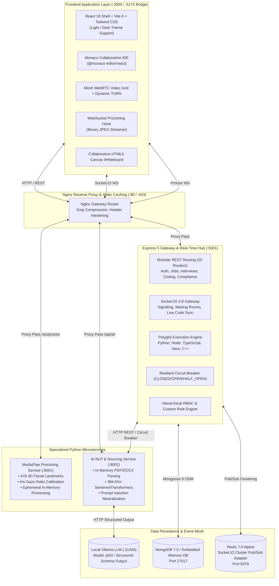
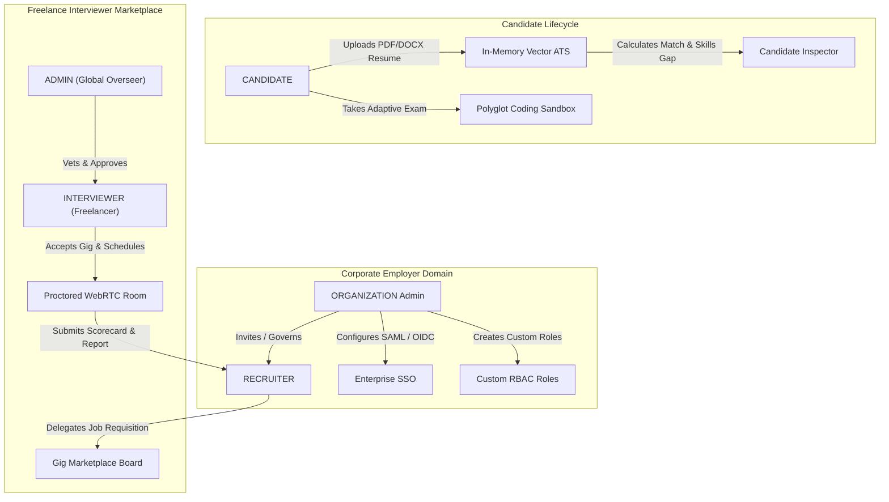

# Procruit (formerly Axiocruit) — Enterprise Autonomous Talent Intelligence & Assessment Ecosystem

<p align="center">
  
  
  
  
  
  
  
  
  
</p>

---

## 1. Executive Summary & Core Mission

**Procruit** (formerly *Axiocruit*) is an enterprise-grade, autonomous, full-lifecycle technical hiring and biometric assessment ecosystem. Engineered from first principles for fast-scaling engineering teams, recruitment organizations, and freelance interviewers, Procruit replaces subjective evaluation and keyword-stuffed resumes with mathematically calibrated talent intelligence, real-time computer vision proctoring, sandboxed polyglot coding tests, and an integrated two-sided marketplace.

### The Four Problems Procruit Solves

1. **Resume Keyword Gaming & ATS Fraud**:
   Traditional Applicant Tracking Systems rely on naive string matching or regular expressions. Candidates easily game these systems by pasting invisible, white-text keywords or using prompt injection techniques. Procruit extracts candidate documents directly in RAM, generates **384-dimensional dense semantic vector embeddings** via `SentenceTransformer("all-MiniLM-L6-v2")`, computes continuous cosine similarity, and pairs this with `spaCy` syntactic token extraction to identify genuine engineering competency and explicit skill gaps.
2. **Cheating & Integrity Loss in Remote Technical Testing**:
   Remote coding assessments are plagued by secondary screens, external collaboration, tab switching, and unauthorized AI assistance. Procruit deploys a dedicated Python microservice that streams camera frames ephemerally over WebSockets. Using **Google MediaPipe's 478 3D facial landmark mesh**, it computes real-time horizontal and vertical iris gaze vectors without recording or persisting raw video to disk.
3. **Senior Engineering Time Burnout**:
   Engineering leaders and staff engineers frequently burn 15–20 hours per week conducting repetitive initial screening interviews. Procruit allows organizations to delegate technical interviews to vetted freelance domain experts through an integrated gig board with Stripe escrow payments, automated WebRTC interview rooms, and post-interview AI scorecards.
4. **Static, Predictable Coding Assessments**:
   Traditional platforms present fixed algorithmic questions that can be memorized or looked up on LeetCode. Procruit implements an **Adaptive Algorithmic Testing Engine** that monitors candidate pass/fail rates in real-time, dynamically escalating or demoting difficulty (`very_easy` $\leftrightarrow$ `easy` $\leftrightarrow$ `medium` $\leftrightarrow$ `hard`) and category tracks (`basics` $\to$ `oop` $\to$ `dsa`) across five supported programming languages in a secured, sandboxed runtime.

```
┌────────────────────────────────────────────────────────────────────────────────────────┐
│                                   PROCRUIT PLATFORM                                    │
├─────────────────────┬──────────────────────┬────────────────────┬──────────────────────┤
│    AUTONOMOUS ATS   │  BIOMETRIC INTEGRITY │  COLLABORATIVE IDE │ PIPELINE MARKETPLACE │
│   Dense Embeddings  │  478-Point FaceMesh  │  Monaco Execution  │ Delegated Gigs       │
│  SentenceTransforms │  Gaze Vector Tracker │ Multi-Lang Sandbox │ Stripe Escrow Escrow │
│  In-Memory Zero-Disk│  Dynamic Calibration │ Unit Test Runner   │ 360 Hiring Dossiers  │
└─────────────────────┴──────────────────────┴────────────────────┴──────────────────────┘
```

---

## 2. System Architecture & Network Topology

Procruit is architected as an asynchronous, decoupled microservices mesh designed for sub-millisecond real-time coordination, horizontal clustering, and zero-disk candidate privacy.



### Port Matrix & Service Inventory

| Port | Service Name | Runtime Stack | Transport Protocol | Primary Responsibilities |
| :---: | :--- | :--- | :--- | :--- |
| **`3000`** | **Frontend Client** | React 19.2, Vite 6, Tailwind CSS | HTTP / WebSocket | Single Page Application, Monaco code editor, WebRTC video grid, candidate dashboard. |
| **`5173`** | **Legacy Redirect Bridge** | Node.js HTTP Shim | HTTP | Transparently catches legacy Vite dev port requests and redirects to port 3000. |
| **`5001`** | **Express API Gateway** | Node.js 20+, Express 5.2, Socket.IO | HTTP / WebSocket | Central gateway, JWT authentication, WebRTC mesh signaling, sandboxed code runner. |
| **`8001`** | **Proctoring Microservice** | Python 3.11, FastAPI, MediaPipe | HTTP / WebSocket | Ephemeral computer-vision gaze tracking, face count detection, baseline calibration. |
| **`8002`** | **AI NLP Microservice** | Python 3.11, FastAPI, PyTorch | HTTP | In-memory resume parsing, dense vector embeddings, prompt injection containment. |
| **`6379`** | **Redis Cluster Adapter** | Redis 7.0 Alpine | Redis TCP | Socket.IO `@socket.io/redis-adapter` for multi-instance event synchronization. |
| **`27017`**| **MongoDB Database** | MongoDB 7.0 Enterprise | Mongo Wire Protocol | Persistent document store (falls back to `mongodb-memory-server` in dev mode). |
| **`11434`**| **Local Ollama LLM** | Ollama (`phi3`) | HTTP JSON | Generates automated post-interview candidate evaluations and rubrics. |
| **`80/443`**| **Nginx Reverse Proxy** | Nginx Alpine | HTTP / HTTPS | Production reverse proxy, TLS termination, gzip compression, client static hosting. |

---

## 3. User Roles, Security Taxonomy & The 5 Core Lifecycles

Procruit organizes platform permissions through a canonical 5-tier user taxonomy defined in [`server/schemas/roleTaxonomy.js`](file:///d:/projects/Procruit-main/server/schemas/roleTaxonomy.js) backed by hierarchical role-based access control (RBAC) and granular permission resolving in [`server/schemas/permissionTaxonomy.js`](file:///d:/projects/Procruit-main/server/schemas/permissionTaxonomy.js):



### 1. Canonical Roles
1. **`ORGANIZATION`**:
   - Represents the corporate employer tenant.
   - Manages company profile, department hierarchies, and billing.
   - Invites and provisions team recruiters with custom role-based permissions (`organization:manage_team`, `organization:manage_sso`).
   - Configures enterprise SSO (SAML 2.0 / OIDC) and automated Webhook subscriptions.
2. **`RECRUITER`**:
   - Creates, publishes, and archives job requisitions.
   - Reviews incoming candidate applications via the **Interactive Candidate Inspector Drawer**.
   - Inspects AI match percentages, matched vs missing skills, and adaptive coding test scores.
   - Delegates technical screening rounds to vetted freelance interviewers on the marketplace.
   - Reviews freelancer candidate proposals and finalizes offers.
3. **`INTERVIEWER` (Freelance Technical Interviewer)**:
   - Sets hourly consultation rates, technical skill proficiencies, and weekly availability blocks.
   - Browses the Freelancer Gig Board and claims open interview requisitions.
   - Conducts proctored live interviews using the collaborative Monaco IDE, WebRTC video grid, and digital whiteboard.
   - Submits structured evaluation scorecards, numerical rubric ratings, and candidate proposals back to recruiters.
4. **`CANDIDATE`**:
   - Searches active job requisitions across organizations.
   - Uploads PDF/DOCX resumes for instant mathematical alignment feedback.
   - Completes proctored adaptive coding assessments with automated test case evaluation.
   - Joins live WebRTC interview rooms with real-time biometric proctoring and code execution.
5. **`ADMIN`**:
   - Global system administrator.
   - Audits centralized security logs, monitors SIEM exports, and tracks platform metrics.
   - Vets, approves, or rejects pending freelance interviewer applications.
   - Manages platform-wide compliance, data retention policies, and GDPR erasure requests.

### 2. Granular RBAC Permission Taxonomy
The platform defines 24 granular permissions with hierarchical wildcard matching (`*`, `jobs:*`, `applications:*`, etc.):
- **Jobs**: `jobs:create`, `jobs:read`, `jobs:update`, `jobs:delete`, `jobs:delegate`
- **Applications**: `applications:read`, `applications:update_status`, `applications:export`
- **Interviews**: `interviews:schedule`, `interviews:conduct`, `interviews:review`, `interviews:pay`
- **Assessments**: `assessments:create`, `assessments:grade`, `assessments:view_code`
- **Candidates**: `candidates:read`, `candidates:export`, `candidates:anonymize`
- **Organization**: `organization:manage_team`, `organization:manage_sso`, `organization:manage_webhooks`, `organization:view_billing`
- **Governance**: `compliance:manage`, `audit_logs:read`

---

## 4. Subsystems Deep Dive & Technical Architecture

### 4.1. Identity, Authentication & Session Security

Located in [`server/controllers/authController.js`](file:///d:/projects/Procruit-main/server/controllers/authController.js) and [`server/middleware/securityMiddleware.js`](file:///d:/projects/Procruit-main/server/middleware/securityMiddleware.js):

- **Dual-Token Pattern**:
  - **Access Token**: Short-lived (15 minutes), signed with `JWT_SECRET`, containing user ID, role, and organization tenancy.
  - **Refresh Token**: High-entropy 40-byte cryptographically secure random string (`crypto.randomBytes(40).toString('hex')`). Stored in an `httpOnly`, `sameSite: 'strict'`, `secure: true` (in production) cookie.
- **Refresh Token Rotation & Family Reuse Detection**:
  - Every session is issued a unique `familyId`.
  - When a refresh token is presented at `POST /api/auth/refresh`, its hash (SHA-256) is located in the `Session` collection.
  - If valid, the current token is immediately marked `isRevoked: true`, and a new refresh token is issued under the identical `familyId`.
  - **Replay Attack Containment**: If an already-revoked refresh token is ever presented, Procruit detects a token theft or replay attack. The system immediately revokes **all** sessions sharing that `familyId` (`await Session.updateMany({ familyId }, { isRevoked: true })`), clears the client cookies, and writes a critical security event to `AuditLog`.
  - **Automatic Expiration Sweep**: The `Session` collection maintains a native MongoDB TTL index on `expiresAt` (`{ expireAfterSeconds: 0 }`), ensuring stale session documents are purged automatically by MongoDB background threads.
- **Parametric Route Shadowing Defense**:
  - In Express, wildcard parameters (`/:id`) registered before named routes (`/my-jobs`, `/stats`, `/conversations`) shadow the literal routes, interpreting the literal path as a parameter ID and causing MongoDB cast errors.
  - Procruit strictly structures route registrations so that all named literal endpoints precede parametric wildcards, and enforces `mongoose.isValidObjectId(id)` parameter checks across all controllers to return clean 404s instead of unhandled 500 exceptions.
- **Request Tracing & Rate Limiting**:
  - `correlationMiddleware` tags every incoming HTTP request with a unique `X-Correlation-Id` UUID, preserving audit traces across microservices.
  - In-memory sliding-window rate limiters protect `/api/auth` (5 login attempts per 15 minutes) and general `/api` routes (100 requests per 15 minutes).

### 4.2. Resume Ingestion, Dense Vector ATS & NLP Engine

Located in [`ai-service/main.py`](file:///d:/projects/Procruit-main/ai-service/main.py):

- **Zero-Disk In-Memory Processing**:
  - Resumes (PDF, DOCX) uploaded at `POST /api/applications/:jobId` are held strictly in memory buffers and streamed to the AI microservice via multipart forms.
  - Ingested files are loaded into `io.BytesIO` streams and parsed via `pdfplumber` or `python-docx`. No unencrypted candidate resumes touch the server disk.
- **Decompression Bomb & CPU Starvation Defenses**:
  - PDF extraction enforces a strict 30-page ceiling (`MAX_PAGES = 30`) to neutralize zip-bomb/decompression attacks.
  - ML inference is bounded by `CPU_SEMAPHORE = asyncio.Semaphore(4)` to prevent heavy concurrent embedding calculations from blocking the asynchronous event loop.
- **384-Dimensional Dense Vector Embeddings**:
  - Procruit loads `SentenceTransformer("all-MiniLM-L6-v2")` into GPU/CPU memory during the FastAPI application lifespan.
  - Resumes and technical job descriptions are vectorized into 384-dimensional dense semantic vectors $\vec{v}_{\text{resume}}$ and $\vec{v}_{\text{job}}$.
  - Cosine similarity is computed as:
    $$\text{SemanticFit} = \max\left(0, \frac{\vec{v}_{\text{resume}} \cdot \vec{v}_{\text{job}}}{\|\vec{v}_{\text{resume}}\| \|\vec{v}_{\text{job}}\|}\right) \times 100$$
- **Calibrated Hybrid Scoring Model**:
  - Standard Requisitions: **60% Semantic Fit + 40% Syntactic Keyword Overlap** (via `spaCy en_core_web_sm`).
  - Short / Vague Requisitions (< 5 keywords extracted): The engine dynamically pivots to **85% Semantic Fit + 15% Keyword Overlap** to prevent penalizing candidates against poorly drafted job postings.
- **Prompt Injection Defense & Neutralization**:
  - Candidate resumes, code, and notes are scanned with `INJECTION_PATTERNS` regex for jailbreak signatures (`ignore previous instructions`, `system override`, `suitabilityScore: 100`, `you are now in developer mode`).
  - Untrusted text passes through `_sanitize_untrusted_input()` which neutralizes XML/HTML tags (e.g. `</candidate_code>`).
  - Adversarial attempts trigger an automated Red Flag, deduct 30 points, and strictly clamp the candidate's final suitability score to $\le \mathbf{20/100}$.
- **Resilient Circuit Breaker**:
  - The Express gateway wraps all calls to the AI microservice in [`server/utils/httpClient.js`](file:///d:/projects/Procruit-main/server/utils/httpClient.js) implementing a 3-state Circuit Breaker (`CLOSED`, `OPEN`, `HALF_OPEN`).
  - If 3 consecutive requests to the AI service fail or time out, the circuit trips to `OPEN`, immediately diverting subsequent requests to `heuristicParseFallback()` in [`server/controllers/applicationController.js`](file:///d:/projects/Procruit-main/server/controllers/applicationController.js) so candidate applications are never dropped.

### 4.3. Real-Time Biometric Proctoring & Gaze Tracking

Located in [`proctoring-service/main.py`](file:///d:/projects/Procruit-main/proctoring-service/main.py) and [`hooks/useProctoring.ts`](file:///d:/projects/Procruit-main/hooks/useProctoring.ts):

- **478 3D Facial Landmarks via Google MediaPipe**:
  - The browser client captures camera frames at 3–5 FPS as compressed JPEG blobs and transmits them over a persistent WebSocket (`/ws/proctor`).
  - The microservice evaluates frames using Google MediaPipe Face Landmarker directly in RAM. No video streams or face crops are ever written to disk.
- **Iris Gaze Vector Mathematics**:
  - Left Iris Center: Landmark **468**; Right Iris Center: Landmark **473**.
  - Eye Canthus Corners: Left eye (Landmarks 33, 133); Right eye (Landmarks 362, 263).
  - Horizontal iris ratio is calculated as:
    $$\text{Ratio}_H = \frac{x_{\text{iris}} - x_{\text{inner}}}{x_{\text{outer}} - x_{\text{inner}}}$$
- **Dynamic Baseline Calibration**:
  - Addresses false positives caused by off-center laptop webcams or unusual camera angles.
  - When the assessment starts, the client issues `{ type: "calibrate", samples: 5 }`.
  - The candidate looks directly at their screen while the server computes resting offsets (`baseline_h`, `baseline_v`). Subsequent gaze classifications evaluate relative to this baseline:
    $$\text{Calibrated}_H = \text{Raw}_H - (\text{Baseline}_H - 0.5)$$
- **Biometric Anomaly Scorecard & Telemetry Throttling**:
  - Flags `multiple_faces` if more than one face mesh is detected in frame.
  - Flags `face_lost` if the candidate looks away completely or covers the camera.
  - Client-side hook tracks `visibilitychange` (tab switches), clipboard `copy`/`paste` operations, and `PrintScreen` keystrokes.
  - Realtime gateway throttles repeated anomaly emissions at 3000ms per event type (`PROCTOR_THROTTLE_MS = 3000`) to prevent socket flooding.
  - All anomalies are logged with millisecond timestamps and rendered in the Recruiter/Interviewer Proctoring HUD.

### 4.4. Polyglot Sandboxed Code Execution & Adaptive Engine

Located in [`server/controllers/codingTestController.js`](file:///d:/projects/Procruit-main/server/controllers/codingTestController.js) and [`server/utils/adaptiveEngine.js`](file:///d:/projects/Procruit-main/server/utils/adaptiveEngine.js):

- **Multi-Language Support**:
  - Executes **Python**, **JavaScript (Node.js)**, **TypeScript**, **Java**, and **C++**.
- **Defense-in-Depth Sandbox Isolation**:
  1. **Secret Scrubbing**: `scrubEnvSecrets()` creates a sanitized environment copy, purging `MONGO_URI`, `JWT_SECRET`, `STRIPE_*`, `REDIS_URL`, and any variable matching `KEY`, `PASS`, `TOKEN`, `SECRET`, `CREDENTIAL`, or `URL`.
  2. **Python Security Prelude**:
     Injected at runtime to nullify dangerous OS primitives and block networking:
     ```python
     import sys, os; os.system = None; os.popen = None; os.remove = None; os.unlink = None
     for _m in ['subprocess','socket','shutil','ctypes','multiprocessing','urllib','http','asyncio']:
         sys.modules[_m] = None
     ```
     Executed via `python -I -B -X utf8` (Isolated mode, no bytecode caching).
  3. **Node.js / TypeScript Security Prelude**:
     Overrides `Module._load` to throw errors on importing 10 restricted system modules: `child_process`, `fs`, `net`, `tls`, `worker_threads`, `vm`, `cluster`, `v8`, `dgram`, `dns`.
     Executed via `node --no-addons --max-old-space-size=128`.
  4. **Compiled Language Execution**:
     - **C++**: Compiles via `g++ -O2 -std=c++17 solution.cpp -o solution` (6-second compilation timeout) and executes binary with a 5-second timeout.
     - **Java**: Compiles via `javac -encoding UTF-8 Solution.java` and executes via `java -Xmx128m -Dfile.encoding=UTF-8 Solution`.
  5. **Resource Clamps**: Hard 5,000ms wall-clock execution timeout (`EXEC_TIMEOUT_MS = 5000`) and 64KB stdout/stderr buffer clamp (`MAX_OUTPUT_BYTES = 64 * 1024`).
  6. **Traceback Sanitization**: Host file paths and Windows temporary directories are stripped from error traces, and Python line numbers are automatically decremented by 2 to account for injected security preludes.
  7. **Hidden Test Cases**: Grading assertions marked `hiddenTestCases` are stripped before questions are sent to the client, ensuring private evaluation criteria cannot be leaked via browser developer tools.
- **Adaptive Algorithmic Engine**:
  - Four difficulty tiers: `very_easy` $\leftrightarrow$ `easy` $\leftrightarrow$ `medium` $\leftrightarrow$ `hard`.
  - Three progressive categories: `basics` $\to$ `oop` $\to$ `dsa`.
  - Pass $\to$ Promotes candidate difficulty and category track; Fail $\to$ Demotes difficulty.
  - Employs a 3-tier `$sample` MongoDB aggregation pipeline:
    1. Exact match on target difficulty + category (excluding previously answered questions).
    2. Fallback: target difficulty, any category.
    3. Fallback: any unseen question in the database bank.

### 4.5. Real-Time WebRTC Mesh Signaling, Waiting Room & Socket Hub

Located in [`server/realtime/interviewSignaling.js`](file:///d:/projects/Procruit-main/server/realtime/interviewSignaling.js), [`server/realtime/socketServer.js`](file:///d:/projects/Procruit-main/server/realtime/socketServer.js), and [`server/realtime/chatHandler.js`](file:///d:/projects/Procruit-main/server/realtime/chatHandler.js):

- **Signaling Mesh Protocol**:
  - Full-mesh peer connection establishment handling `offer`, `answer`, and `ice-candidate` exchanges between interviewers and candidates.
- **Waiting Room & Host Controls Protocol**:
  - Candidates entering an interview room before the host interviewer are held in an isolated `waitingRooms` map and receive a `waiting-for-host` status.
  - When the host joins, they receive an `admission-request` event containing candidate metadata and can emit `admit-user` (to admit) or `deny-user` (emits `admission-denied`).
  - Hosts maintain strict moderation capabilities: `kick-user` (emits `kicked-from-room`) and `end-interview` (cleans up active sockets and evicts stranded waiting candidates with `interview-ended`).
- **Collaborative IDE & Whiteboard State Synchronization**:
  - `code-change` and `language-change` synchronize Monaco editor buffers across peers.
  - `request-editor-state` and `editor-state-response` dynamically sync new joiners with current editor state.
  - `whiteboard-update` syncs vector drawing coordinates across the shared HTML5 canvas.
- **Dynamic RFC 5766 TURN Relay Credentials**:
  - Available at `GET /api/interviews/:id/turn-credentials`.
  - Generates HMAC-SHA1 dynamic TURN credentials with a 24-hour expiration timestamp, allowing WebRTC audio and video streams to traverse strict corporate firewalls and symmetric NATs.
- **Horizontal Clustering with Redis**:
  - Socket.IO mounts `@socket.io/redis-adapter` when `REDIS_URL` is configured.
  - Events are broadcasted over Redis pub/sub channels, enabling seamless multi-instance horizontal scaling behind load balancers.

### 4.6. Two-Sided Freelancer Interviewer Marketplace & Stripe Payments

Located in [`server/controllers/freelancerController.js`](file:///d:/projects/Procruit-main/server/controllers/freelancerController.js) and [`server/controllers/stripeController.js`](file:///d:/projects/Procruit-main/server/controllers/stripeController.js):

- **End-to-End Delegation Workflow**:
  1. Recruiter creates a job requisition and delegates technical interviewing to the marketplace (`POST /api/jobs/:jobId/delegate`).
  2. Vetted freelance interviewers browse open requisitions on their Gig Board (`/interviewer/gigs`).
  3. Freelancer claims the gig (`POST /api/freelancers/gigs/accept/:gigId`) or accepts the requisition delegation (`PUT /api/freelancers/delegations/:jobId/accept`).
  4. Freelancer schedules and conducts live technical evaluations in the Monaco/WebRTC room.
  5. Freelancer submits candidate hiring proposal and comprehensive evaluation report (`POST /api/freelancers/delegations/:jobId/propose/:candidateId`).
  6. Recruiter reviews proposal in `/recruiter/review-hires` and approves (`PUT /api/jobs/delegations/:jobId/approve`) or rejects the recommendation.
- **Topology-Aware Transactions (Saga Pattern)**:
  - Controllers inspect `mongoose.connection.client?.topology?.description?.type`.
  - If a replica set or sharded cluster is detected (`ReplicaSetWithPrimary`), operations execute inside native ACID transactions (`session.startTransaction()`).
  - If running in standalone or memory DB mode, operations execute sequentially with manual compensating rollback handlers to maintain zero-config compatibility.
- **Stripe Checkout & Webhook Verification**:
  - Recruiters book freelance interviewers via Stripe Checkout sessions (`POST /api/payments/create-checkout-session`).
  - Stripe webhook events (`checkout.session.completed`) delivered to `POST /api/payments/webhook` are cryptographically verified using `stripe.webhooks.constructEvent(req.rawBody, sig, secret)` using the preserved raw request buffer.
  - Upon verification, the interview payment status updates to `Paid`.

### 4.7. Enterprise Governance: GDPR, Webhooks, SIEM, Storage & Calibration

- **GDPR / CCPA Compliance Engine** ([`server/controllers/complianceController.js`](file:///d:/projects/Procruit-main/server/controllers/complianceController.js)):
  - `POST /api/compliance/gdpr/export`: Exports complete candidate data (profile, applications, test sessions, interviews) in a machine-readable JSON bundle verified by an HMAC SHA-256 integrity checksum.
  - `POST /api/compliance/gdpr/anonymize`: Executes the Right to be Forgotten, scrubbing PII, unlinking applications, and securely deleting uploaded files from disk.
  - Automated retention policies prune:
    - Proctoring logs: **90 days**
    - Coding test sessions: **30 days**
    - Security audit logs: **365 days**
    - Inactive candidate data: **730 days** (2 years)
- **Enterprise Webhook Dispatcher** ([`server/utils/webhookDispatcher.js`](file:///d:/projects/Procruit-main/server/utils/webhookDispatcher.js)):
  - Dispatches event notifications: `application.created`, `assessment.completed`, `interview.scheduled`, `interview.completed`, `proctoring.flagged`, `hire.approved`.
  - Signs every payload with HMAC-SHA256 in the `X-Axiocruit-Signature` header (`sha256=<hex>`), including `X-Axiocruit-Event`, `X-Axiocruit-Delivery`, and `X-Axiocruit-Timestamp`.
  - Enforces a 5-second connection SLA with automated delivery logging in `WebhookDelivery`.
- **Pluggable Storage Abstraction** ([`server/services/storageService.js`](file:///d:/projects/Procruit-main/server/services/storageService.js)):
  - Unified driver interface supporting **Local Filesystem**, **AWS S3**, and **MinIO**.
  - Local filesystem generates HMAC-SHA256 signed presigned tokens base64url-encoded.
  - Supports categories: `resumes`, `avatars`, `recordings`, `artifacts`.
- **Enterprise SIEM Streaming** ([`server/services/siemService.js`](file:///d:/projects/Procruit-main/server/services/siemService.js)):
  - Streams security audit events to enterprise SIEM platforms (Splunk, Datadog, ElasticSearch, Syslog).
  - Formats logs into **Elastic Common Schema (ECS)**, **Common Event Format (CEF)**, or raw JSON with background queue flushing (`flushIntervalMs = 1000`, `batchSize = 10`).
- **Interview Calibration & Panel Scoring** ([`server/services/calibrationService.js`](file:///d:/projects/Procruit-main/server/services/calibrationService.js)):
  - Normalizes multi-interviewer rubrics and scorecards into a weighted 0–100 score.
  - Automatically flags **Calibration Needed** if score spread between panel interviewers is $\ge \mathbf{25}$ points or recommendations split between `Strong Hire` and `No Hire`/`Strong No Hire`.
  - Aggregates ATS match, coding performance, proctoring trust, and interviewer ratings into a 360-degree candidate hiring packet.

### 4.8. Enterprise Single Sign-On (SSO) & IdP Federation

Located in [`server/controllers/ssoController.js`](file:///d:/projects/Procruit-main/server/controllers/ssoController.js) and [`server/routes/ssoRoutes.js`](file:///d:/projects/Procruit-main/server/routes/ssoRoutes.js):
- Supports **SAML 2.0**, **OIDC**, **Okta**, **Azure AD**, and **Google Workspace**.
- Multi-tenant corporate domain routing via `GET /api/auth/sso/lookup?domain=company.com`.
- Just-In-Time (JIT) user account provisioning into the corporate organization with default roles.

---

## 5. Comprehensive Data Model Catalog

Procruit defines 19 Mongoose domain models across identity, assessment, interviewing, and enterprise compliance:

| Model | Schema File | Key Fields & Types | Indexes & Constraints | Purpose |
| :--- | :--- | :--- | :--- | :--- |
| **`User`** | `server/models/User.js` | `name`, `email`, `password`, `role` (enum: `ADMIN`, `ORGANIZATION`, `RECRUITER`, `INTERVIEWER`, `CANDIDATE`), `skills`, `hourlyRate`, `approvalStatus` (`PENDING`, `APPROVED`, `REJECTED`), `organization`, `customRole`, `profilePicture`, `resumeUrl` | Unique on `email` (lowercase) | Core identity, authentication credentials, and canonical role. |
| **`Organization`** | `server/models/Organization.js` | `name`, `admin` (ref: `User`), `website`, `recruiters` (`[ObjectId]`), `ssoConfig` (`enabled`, `provider`, `domains`, `clientId`, `issuer`, `jitProvisioning`) | Index on `ssoConfig.domains` | Corporate tenant, team memberships, and SSO federation. |
| **`Profile`** | `server/models/Profile.js` | `user` (ref: `User`), `headline`, `bio`, `skills`, `experience` (array of subdocs), `education`, `resume`, `hourlyRate`, `yearsOfExperience`, `availability` | Unique on `user` | Extended professional resume, work history, and freelancer metadata. |
| **`Job`** | `server/models/Job.js` | `title`, `description`, `company`, `location`, `type` (`Full-time`, `Contract`, `Part-time`, `Remote`), `skills`, `postedBy` (ref: `User`), `organization` (ref: `Organization`), `applicants`, `status` (`Active`, `Closed`), `delegatedFreelancerId`, `delegationStatus` (`none`, `pending`, `accepted`, `reviewing`, `completed`), `proposedCandidateId` | Compound on `{ postedBy: 1, status: 1 }`, `{ delegatedFreelancerId: 1, delegationStatus: 1 }`, `{ organization: 1 }` | Job requisitions, requirements, and freelance delegation state. |
| **`Application`** | `server/models/Application.js` | `job` (ref: `Job`), `candidate` (ref: `User`), `resumeUrl`, `aiScore`, `matchedKeywords`, `missingKeywords`, `status` (`Applied`, `Screening`, `Interview`, `Offer`, `Rejected`, `Pending AI`, `Proposed`, `Hired`), `appliedAt` | Unique compound on `{ job: 1, candidate: 1 }`, `{ job: 1, status: 1 }`, `{ candidate: 1, appliedAt: -1 }` | Candidate job submission, vector ATS score, and recruitment pipeline stage. |
| **`Interview`** | `server/models/Interview.js` | `candidateId`, `recruiterId`, `interviewerId`, `jobId`, `scheduledTime`, `meetingId`, `status` (`Pending`, `Accepted`, `Rejected`, `Scheduled`, `InProgress`, `Completed`, `Cancelled`), `paymentStatus` (`Unpaid`, `Paid`), `proctorLog` (array of anomaly subdocs), `feedback`, `aiEvaluation` | Unique on `meetingId`, compound on `{ candidateId: 1, scheduledTime: -1 }`, `{ recruiterId: 1, scheduledTime: -1 }`, `{ interviewerId: 1, scheduledTime: -1 }` | Proctored WebRTC interview room, biometric telemetry log, and AI evaluation. |
| **`CodingQuestion`** | `server/models/CodingQuestion.js` | `title`, `description`, `functionName`, `starterTemplates` (`python`, `javascript`, `typescript`, `cpp`, `java`), `difficulty` (`very_easy`, `easy`, `medium`, `hard`), `category` (`basics`, `oop`, `dsa`), `visibleTestCases`, `hiddenTestCases` | Compound on `{ difficulty: 1, category: 1 }` | Algorithmic challenges with visible and private grading test cases. |
| **`TestSession`** | `server/models/TestSession.js` | `candidateId`, `jobId`, `questionsAsked` (`[ObjectId]`), `responses` (array of code, language, passed, score), `currentDifficulty`, `currentCategory`, `status` (`in_progress`, `completed`), `finalScore`, `startedAt`, `completedAt` | Compound on `{ candidateId: 1, jobId: 1 }`, `{ status: 1, startedAt: -1 }` | Adaptive testing session, candidate code submissions, and dynamic difficulty tracker. |
| **`InterviewGig`** | `server/models/InterviewGig.js` | `recruiterId`, `jobId`, `requiredSkills`, `status` (`open`, `assigned`, `completed`), `assignedFreelancerId`, `candidateId`, `proposedDate`, `notes` | Standard references | Requisition screening gig posted to the Freelancer Gig Board. |
| **`FreelancerService`**| `server/models/FreelancerService.js` | `freelancerId`, `title`, `description`, `skills`, `price`, `durationMinutes`, `isActive` | Index on `freelancerId`, `isActive` | Freelance interviewer listing in the Recruiter Service Marketplace. |
| **`Availability`** | `server/models/Availability.js` | `freelancerId`, `dayOfWeek` (0–6), `startTime`, `endTime` | Timestamps | Weekly available consultation blocks for interview booking. |
| **`Session`** | `server/models/Session.js` | `userId`, `refreshTokenHash`, `familyId`, `isRevoked`, `expiresAt`, `userAgent`, `ipAddress` | TTL index on `expiresAt` (`expireAfterSeconds: 0`), index on `refreshTokenHash`, `familyId` | Dual-token refresh session, family reuse detection, and replay defense. |
| **`AuditLog`** | `server/models/AuditLog.js` | `actor` (`id`, `email`, `role`), `action`, `resource` (`type`, `id`), `details`, `ip`, `userAgent`, `timestamp` | Compound on `{ timestamp: -1, action: 1 }` | Tamper-evident administrative and security audit trail. |
| **`Message`** | `server/models/Message.js` | `senderId`, `receiverId`, `content`, `isRead`, `createdAt` | Compound on `{ senderId: 1, receiverId: 1, createdAt: -1 }`, `{ receiverId: 1, isRead: 1 }` | Direct messages exchanged between platform participants. |
| **`CustomRole`** | `server/models/CustomRole.js` | `organization`, `name`, `description`, `permissions` (`[String]`), `isSystemDefault` | Unique compound on `{ organization: 1, name: 1 }` | Enterprise tenant-specific custom RBAC roles with assigned permissions. |
| **`EvaluationRubric`**| `server/models/EvaluationRubric.js`| `organization`, `title`, `description`, `criteria` (`name`, `weight`, `levels`), `isDefault` | Compound on `{ organization: 1, title: 1 }` | Configurable multi-criteria interview evaluation rubrics. |
| **`InterviewScorecard`**| `server/models/InterviewScorecard.js`| `interviewId`, `jobId`, `candidateId`, `interviewerId`, `rubricId`, `ratings`, `overallRecommendation`, `calculatedScore`, `candidateSummary`, `privateNotes` | Unique compound on `{ interviewId: 1, interviewerId: 1 }`, compound on `{ candidateId: 1, jobId: 1 }` | Structured evaluation ratings and recommendations per interviewer. |
| **`WebhookSubscription`**| `server/models/WebhookSubscription.js`| `organization`, `targetUrl`, `secretKey`, `events`, `isActive`, `description` | Compound on `{ organization: 1, isActive: 1 }` | Enterprise webhook endpoints, subscribed event types, and HMAC signing keys. |
| **`WebhookDelivery`**| `server/models/WebhookDelivery.js`| `subscriptionId`, `organization`, `event`, `payload`, `targetUrl`, `responseStatus`, `responseBody`, `deliveryDurationMs`, `attempt`, `success`, `error` | Compound on `{ organization: 1, deliveredAt: -1 }` | Historical webhook dispatch logs, response codes, and retry records. |

---

## 6. Repository Structure & Directory Map

```
Procruit-main/
├── ai-service/                         # Python NLP & Semantic Vector Microservice (Port 8002)
│   ├── main.py                         # FastAPI server: SentenceTransformers, spaCy, Ollama eval
│   ├── requirements.txt                # Python dependencies (fastapi, torch, sentence-transformers, spacy)
│   ├── test_phase8.py                  # Prompt injection defense & red-flag sync test suite
│   └── venv/                           # Isolated Python virtual environment
│
├── proctoring-service/                 # Python Biometric Computer Vision Microservice (Port 8001)
│   ├── main.py                         # FastAPI WebSocket gaze, iris, and multi-face tracker
│   ├── face_landmarker.task            # Google MediaPipe 478-keypoint biometric model
│   ├── requirements.txt                # Python dependencies (mediapipe, opencv-python, fastapi)
│   ├── test_phase7.py                  # Gaze calibration & WebSocket protocol test suite
│   └── venv/                           # Isolated Python virtual environment
│
├── server/                             # Express 5 API Gateway & Real-Time Engine (Port 5001)
│   ├── bootstrap/                      # Application lifecycle & server assembly
│   │   ├── app.js                      # Express configuration, security middleware, route registration
│   │   ├── migrateRoles.js             # RBAC role migration utilities
│   │   └── server.js                   # HTTP server & Socket.IO initialization
│   ├── config/                         # Configuration & Database connection
│   │   ├── db.js                       # Mongoose 9 ODM connection & memory server fallback
│   │   ├── jwt.js                      # JWT secret helper
│   │   └── seedDefaultData.js          # Auto-seeding for demo accounts & sample questions
│   ├── controllers/                    # 20 Modular REST Controllers
│   │   ├── adminController.js          # System overview, user management, audit logs, cascades
│   │   ├── applicationController.js    # Resume upload, vector ATS, candidate ranking
│   │   ├── authController.js           # Dual-token auth, refresh token rotation, replay defense
│   │   ├── codingTestController.js     # Polyglot sandbox runner, adaptive question engine
│   │   ├── complianceController.js     # GDPR export, anonymization, retention purges
│   │   ├── freelancerController.js     # Gig board, service management, hire proposals
│   │   ├── interviewController.js      # Interview rooms, dynamic TURN, proctoring logs
│   │   ├── jobController.js            # Job requisitions, delegation workflows
│   │   ├── messageController.js        # Internal messaging & conversation threads
│   │   ├── metricsController.js        # Prometheus metrics export & JSON telemetry
│   │   ├── organizationController.js   # Org administration, recruiter invitations
│   │   ├── recruiterController.js      # Recruiter public profile inspection
│   │   ├── roleController.js           # Custom RBAC role definitions & assignment
│   │   ├── scorecardController.js      # Panel scorecards, rubrics, candidate packets
│   │   ├── siemController.js           # SIEM exporter configuration & manual flush
│   │   ├── ssoController.js            # Corporate SSO domain lookup, SAML/OIDC exchange
│   │   ├── storageController.js        # Presigned upload/download URL generation
│   │   ├── stripeController.js         # Stripe checkout sessions & HMAC webhook fulfillment
│   │   ├── userController.js           # User profile management & avatar uploads
│   │   └── webhookController.js        # Webhook subscriptions & delivery logs
│   ├── guards/                         # Route guards
│   │   ├── authGuard.js                # Token validation guard
│   │   └── roleGuard.js                # Role assertion guard
│   ├── middleware/                     # Middleware pipeline
│   │   ├── authMiddleware.js           # Bearer token parsing & role authorization
│   │   ├── dbCheckMiddleware.js        # Database readiness guard
│   │   ├── errorMiddleware.js          # Centralized error handler & status mapping
│   │   ├── metricsMiddleware.js        # Request latency & throughput recording
│   │   ├── permissionMiddleware.js     # Granular RBAC permission validator
│   │   ├── roleMiddleware.js           # Role validation helper
│   │   ├── securityMiddleware.js       # Correlation IDs, rate limiters, security headers
│   │   └── uploadMiddleware.js         # Multer in-memory resume buffer handler
│   ├── models/                         # 19 Mongoose Schemas & Domain Models
│   │   ├── Application.js              # Job application, ATS score, matched/missing skills
│   │   ├── AuditLog.js                 # Centralized tamper-evident security audit trail
│   │   ├── Availability.js             # Freelancer weekly time slot calendar
│   │   ├── CodingQuestion.js           # Polyglot coding challenges with visible & hidden test cases
│   │   ├── CustomRole.js               # Enterprise tenant-specific custom RBAC roles
│   │   ├── EvaluationRubric.js         # Configurable interview evaluation criteria
│   │   ├── FreelancerService.js        # Freelance interviewer listings & hourly rates
│   │   ├── Interview.js                # Interview sessions, WebRTC rooms, payment status
│   │   ├── InterviewGig.js             # Delegated job requisition gigs
│   │   ├── InterviewScorecard.js       # Structured interview ratings & recommendations
│   │   ├── Job.js                      # Job requisitions, delegation status, requirements
│   │   ├── Message.js                  # Direct messaging logs between users
│   │   ├── Organization.js             # Corporate tenants, SSO configuration, domains
│   │   ├── Profile.js                  # User profile, skills, bio, rate, contact details
│   │   ├── Session.js                  # Refresh token sessions, familyId replay tracking
│   │   ├── TestSession.js              # Adaptive coding test sessions, answer history
│   │   ├── User.js                     # Core identity, hashed password, canonical role
│   │   ├── WebhookDelivery.js          # Webhook delivery audit logs & HTTP response status
│   │   └── WebhookSubscription.js      # Webhook subscriber endpoints & event filters
│   ├── realtime/                       # WebRTC Signaling & Socket.IO Handlers
│   │   ├── chatHandler.js              # Direct messaging & in-room live text chat
│   │   ├── interviewSignaling.js       # WebRTC mesh signaling, waiting room & host controls
│   │   ├── proctorHandler.js           # Biometric proctoring telemetry relay (3s throttle)
│   │   └── socketServer.js             # Socket.IO lifecycle & Redis adapter mounting
│   ├── routes/                         # 20 Express Modular Route Declarations
│   ├── schemas/                        # Canonical role & permission taxonomies
│   ├── services/                       # Storage, SIEM, and Calibration infrastructure services
│   └── utils/                          # Adaptive engine, circuit breaker, audit logger, metrics
│
├── src/                                # Frontend Application Source (React 19.2 + Vite 6)
│   ├── core/                           # Application shell, providers, and layout wrappers
│   │   ├── AdminLayout.tsx             # System admin navigation shell
│   │   ├── App.tsx                     # Top-level route tree & React.lazy() dynamic code splitting
│   │   ├── AuthContext.tsx             # Global authentication and session state provider
│   │   ├── ErrorBoundary.tsx           # Top-level React error boundary
│   │   ├── Layouts.tsx                 # Public & dashboard navigation layouts
│   │   ├── ThemeContext.tsx            # Persistent Dark/Light mode theme provider
│   │   └── api.ts                      # Axios/Fetch API client with auth interceptors
│   ├── features/                       # Feature-Driven Domain Modules
│   │   ├── admin/                      # Admin overview, user management, job moderation
│   │   ├── assessments/                # Coding test runner, adaptive test result reviews
│   │   ├── auth/                       # Sign in, registration, role selection
│   │   ├── candidates/                 # Candidate portal, applications, ranked candidate drawer
│   │   ├── feedback/                   # Interview feedback modals & scorecards
│   │   ├── interview-room/             # Live interview room, Monaco IDE, WebRTC, Whiteboard, HUD
│   │   │   ├── AdaptiveTestPanel.tsx   # In-room adaptive coding panel
│   │   │   ├── AdmissionRequestsOverlay.tsx # Host waiting room admission popup
│   │   │   ├── ChatPanel.tsx           # In-room live chat panel
│   │   │   ├── EndInterviewModal.tsx   # Host session conclusion confirmation
│   │   │   ├── InterviewRoomContainer.tsx # Core full-screen interview layout manager
│   │   │   ├── MonacoCodeEditor.tsx    # Live Monaco editor with syntax highlighting
│   │   │   ├── NotesPanel.tsx          # Private interviewer notepad
│   │   │   ├── ProctoringHUD.tsx       # Real-time gaze & anomaly visual heads-up display
│   │   │   ├── RoomControlBar.tsx      # Media toggle, whiteboard, and assessment controls
│   │   │   ├── WaitingRoom.tsx         # Pre-interview candidate waiting lobby
│   │   │   ├── WebRTCVideoGrid.tsx     # Mesh video streams with dynamic aspect ratio
│   │   │   ├── WhiteboardCanvas.tsx    # Collaborative HTML5 vector whiteboard
│   │   │   └── useInterviewSignaling.ts# Client WebRTC peer negotiation & socket hook
│   │   ├── interviewer/                # Freelancer dashboard, gig board, service management
│   │   ├── organization/               # Org settings, recruiter team management, SSO config
│   │   ├── public/                     # Landing page, 3D hardware perspective showcase, hero
│   │   └── recruiter/                  # Recruiter dashboard, pipeline analytics, job manager
│   ├── theme/                          # Visual tokens, design system colors
│   └── ui/                             # Reusable UI primitives (Buttons, Badges, Modals)
│
├── components/                         # Shared UI Components & Modals
│   ├── AIReportCard.tsx                # Post-interview AI evaluation summary card
│   ├── ApplicantReviewModal.tsx        # Candidate application review modal
│   ├── ApplyWithCVModal.tsx            # Candidate resume upload & apply modal
│   ├── CandidateInspectorDrawer.tsx    # Slide-out inspector with SVG score gauges & skill chips
│   ├── CandidateTable.tsx              # Tabular applicant browser with filtering and sorting
│   ├── ChangePasswordForm.tsx          # Password update and session invalidation form
│   ├── ErrorBoundary.tsx               # Component-level error boundary fallback
│   ├── FreelancerAvailability.tsx      # Weekly calendar time-slot editor
│   ├── FreelancerGigBoard.tsx          # Real-time freelance gig claim board
│   ├── FreelancerProfile.tsx           # Interviewer skills and hourly rate editor
│   ├── FreelancerPublicProfileModal.tsx # Read-only public interviewer profile modal
│   ├── InterviewsTab.tsx               # Interview management & meeting card scheduler
│   ├── JobReviewModal.tsx              # Job requisition preview and details modal
│   ├── Layouts.tsx                     # Legacy layout bridges and navigation bars
│   ├── MessagesTab.tsx                 # Threaded real-time direct chat interface
│   ├── SubmitFeedbackModal.tsx         # Post-interview feedback and ratings form
│   ├── ThemeContext.tsx                # Context bridge for legacy theme callers
│   ├── Toast.tsx                       # Global notification toaster
│   └── UI.tsx                          # Base SVG icons, badges, and button primitives
│
├── hooks/                              # React Hooks
│   └── useProctoring.ts                # WebSocket proctoring streamer & browser event tracker
│
├── tests/                              # Automated Test & Quality Assurance Battery (32 Suites)
│   ├── e2e/                            # Comprehensive 169-test E2E verification suite
│   ├── test_phase2_security_and_audit.cjs          # Auth & token reuse tests
│   ├── test_phase3_gateway_multitenant_cascades.cjs # Route ordering & cascade deletion tests
│   ├── test_phase4_circuitbreaker_indexing_ats.cjs  # Circuit breaker & ATS tests
│   ├── test_phase5_adaptive_sandbox_polyglot.cjs    # Sandbox & adaptive test engine tests
│   ├── test_phase6_socket_redis_turn_webrtc.cjs     # Socket.IO & WebRTC signaling tests
│   ├── test_phase7_proctoring_v2.cjs                # Proctoring calibration tests
│   ├── test_phase8_prompt_defense_redflags.cjs      # Prompt injection defense tests
│   ├── test_phase11_compliance_gdpr.cjs             # GDPR export & anonymization tests
│   ├── test_phase12_webhooks.cjs                    # Webhook signing & dispatch tests
│   ├── test_phase13_observability_metrics.cjs       # Prometheus metrics tests
│   ├── test_phase14_enterprise_sso.cjs              # SSO login flow tests
│   ├── test_phase15_storage_service.cjs             # Presigned URL storage tests
│   ├── test_phase16_rbac_custom_roles.cjs           # Granular RBAC tests
│   ├── test_phase17_siem_exporter.cjs               # SIEM audit log stream tests
│   ├── test_phase18_scorecards_calibration.cjs      # Calibration & panel scorecard tests
│   ├── m3_challenger_adversarial_suite.js           # 80-test bundle & alias stress suite
│   ├── m3_adversarial_subcomponents.test.js         # 36-test visual & token invariant suite
│   ├── m3_empirical_challenger_v2.test.js           # 61-test wiring & null-safety harness
│   └── m4_backend_invariants_adversarial.test.js    # 49-test backend invariants suite
│
├── Dockerfile.ai                       # Production container definition for AI service
├── Dockerfile.client                   # Production container definition for React client
├── Dockerfile.proctor                  # Production container definition for Proctoring service
├── Dockerfile.server                   # Production container definition for Express gateway
├── docker-compose.yml                  # Complete multi-container orchestration definition
├── nginx.conf                          # Production Nginx reverse proxy configuration
├── package.json                        # Root workspace scripts & client dependencies
├── start_all.bat                       # One-click Windows development boot script
├── tsconfig.json                       # Strict TypeScript configuration
└── vite.config.ts                      # Vite 6 config with vendor chunk splitting
```

---

## 7. Comprehensive API & Protocol Catalog

### 7.1. Express Gateway REST API (`http://localhost:5001`)

#### 1. Authentication & Single Sign-On (`/api/auth`, `/api/auth/sso`)
- `POST /api/auth/register-org`: Register new corporate organization tenant.
- `POST /api/auth/register-candidate`: Register candidate profile.
- `POST /api/auth/register-freelancer`: Register freelance technical interviewer (defaults to pending approval).
- `POST /api/auth/register-recruiter`: Invite/provision a recruiter under an authenticated organization.
- `POST /api/auth/login`: Authenticate with email/password; returns short-lived JWT and sets `httpOnly` refresh cookie.
- `POST /api/auth/refresh`: Rotate refresh token, verify `familyId`, and issue new access token.
- `POST /api/auth/logout`: Revoke active session and clear client cookies.
- `GET /api/auth/me`: Retrieve currently authenticated user context.
- `POST /api/auth/change-password`: Update password and invalidate all active session tokens.
- `GET /api/auth/recruiters`: List recruiters under authenticated organization.
- `GET /api/auth/sso/lookup?domain=company.com`: Check corporate domain for configured SSO provider.
- `POST /api/auth/sso/initiate`: Generate HMAC-signed SAML/OIDC authentication state.
- `POST /api/auth/sso/callback`: Exchange IdP authorization assertion for Procruit user session.

#### 2. User & Profile Management (`/api/users`)
- `GET /api/users/profile`: Retrieve current authenticated user profile and populated extended details.
- `PUT /api/users/profile`: Update user profile (name, headline, bio, skills, experience, projects, hourly rate).
- `POST /api/users/profile-picture`: Upload user profile avatar image (multipart form).
- `GET /api/users/interviewers`: Query freelance interviewers with optional `skill` and `maxRate` query filters.
- `GET /api/users/candidates`: Directory list of candidates (restricted to Recruiter, Interviewer, Org, Admin).
- `GET /api/users/by-id/:id`: Lookup user profile details by MongoDB ObjectId.
- `GET /api/users/:email`: Lookup user profile details by email address.
- `POST /api/users/resume`: Upload resume file directly to user profile.

#### 3. Organization Administration & Custom Roles (`/api/organization`)
- `GET /api/organization/details`: Fetch organization company profile and admin details.
- `PUT /api/organization/details`: Update organization metadata (name, website, description).
- `GET /api/organization/jobs`: Retrieve all job requisitions belonging to the organization.
- `GET /api/organization/recruiters`: List team recruiters provisioned under the organization.
- `POST /api/organization/recruiters/invite`: Invite and provision a new recruiter into the organization.
- `DELETE /api/organization/recruiters/:id`: Remove recruiter membership and revoke access.
- `GET /api/organization/sso`: Fetch enterprise SSO and IdP configuration.
- `PUT /api/organization/sso`: Update SSO settings (SAML/OIDC parameters, enforced status, allowed domains).
- `GET /api/organization/permissions`: List all platform-supported granular RBAC permission strings.
- `GET /api/organization/roles`: List tenant custom RBAC roles.
- `POST /api/organization/roles`: Create tenant custom RBAC role with selected permission strings.
- `PUT /api/organization/roles/:id`: Update existing custom RBAC role permissions or title.
- `DELETE /api/organization/roles/:id`: Delete custom RBAC role.
- `POST /api/organization/members/:id/role`: Assign custom RBAC role to team member.

#### 4. Jobs & Requisitions (`/api/jobs`)
- `GET /api/jobs`: List open job requisitions (public, with optional authentication context).
- `GET /api/jobs/my-jobs`: List jobs created by the authenticated recruiter/organization.
- `GET /api/jobs/applications/received`: List all candidate submissions across recruiter jobs.
- `GET /api/jobs/delegations/reviewing`: List candidate proposals awaiting recruiter review.
- `PUT /api/jobs/delegations/:jobId/approve`: Approve a delegated candidate hiring proposal.
- `GET /api/jobs/hirings/new`: List newly hired candidates.
- `GET /api/jobs/past-jobs`: List closed or archived job postings.
- `GET /api/jobs/:id`: Fetch specific job requisition details.
- `POST /api/jobs`: Create and publish a new job requisition.
- `PUT /api/jobs/:id`: Update job details, requirements, or status (`Active`, `Closed`).
- `POST /api/jobs/:id/apply`: Submit candidate application.
- `POST /api/jobs/:jobId/delegate`: Delegate job technical screening to the freelance marketplace.
- `PUT /api/jobs/applications/:id/status`: Update candidate stage (`Applied`, `Screening`, `Interview`, `Offer`, `Rejected`, `Pending AI`, `Proposed`, `Hired`).

#### 5. Applications & Dense Vector ATS (`/api/applications`)
- `GET /api/applications/my-applications`: Fetch applications submitted by the authenticated candidate.
- `POST /api/applications/:jobId`: Upload resume (PDF/DOCX) for in-memory vector embedding and parsing.
- `GET /api/applications/:jobId/candidates`: Retrieve AI-ranked candidate list with continuous match scores.
- `POST /api/applications/:applicationId/retry-ai`: Re-run vector embedding analysis on an existing application.

#### 6. Proctored Interviews & Video Rooms (`/api/interviews`)
- `POST /api/interviews/schedule`: Schedule an interview between candidate and interviewer.
- `GET /api/interviews/my-interviews`: Fetch scheduled interviews for the current user.
- `GET /api/interviews/eligible-candidates`: Fetch candidate pool qualified for interview scheduling.
- `GET /api/interviews/:id`: Fetch interview room session and verify authorization.
- `GET /api/interviews/:id/turn-credentials`: Generate dynamic RFC 5766 HMAC-SHA1 TURN relay credentials.
- `PATCH /api/interviews/:id/status`: Update interview status (`Pending`, `Accepted`, `Rejected`, `Scheduled`, `InProgress`, `Completed`, `Cancelled`).
- `DELETE /api/interviews/:id`: Cancel/soft-delete an interview session.
- `POST /api/interviews/:id/feedback`: Submit interviewer notes, ratings, and qualitative review.
- `GET /api/interviews/:id/proctor-log`: Retrieve timestamped biometric proctoring telemetry.
- `POST /api/interviews/:id/proctor-log`: Ingest proctoring telemetry events from client.
- `POST /api/interviews/:id/complete`: Conclude interview session and trigger background AI evaluation.

#### 7. Polyglot Sandbox & Adaptive Testing (`/api/coding-test`)
- `POST /api/coding-test/start`: Initialize or resume an adaptive coding test session for a job.
- `GET /api/coding-test/next-question`: Retrieve next adaptive question based on candidate performance.
- `GET /api/coding-test/:sessionId/next`: Fetch next question in an active session.
- `POST /api/coding-test/:sessionId/submit`: Execute candidate code in polyglot sandbox and grade test cases.
- `POST /api/coding-test/:sessionId/end`: Complete coding test and compute overall score.
- `GET /api/coding-test/:sessionId/result`: Fetch comprehensive performance telemetry and pass rates.
- `GET /api/coding-test/job/:jobId/candidate/:candidateId`: Fetch candidate test session for recruiter review.

#### 8. Freelance Marketplace & Interviewer Services (`/api/freelancers`, `/api/recruiter/services`)
- `GET /api/recruiter/services`: Browse freelance interviewer service listings.
- `GET /api/recruiter/freelancers/:id`: View read-only public profile of freelance interviewer.
- `POST /api/recruiter/services/:serviceId/book`: Book an interviewer service and generate pending interview.
- `GET /api/freelancers/services`: List services published by the authenticated interviewer.
- `POST /api/freelancers/services`: Publish a new interview service listing.
- `PUT /api/freelancers/services/:serviceId`: Update service details, pricing, or active state.
- `DELETE /api/freelancers/services/:serviceId`: Remove a service listing.
- `PUT /api/freelancers/requests/:id/accept`: Accept recruiter booking request.
- `PUT /api/freelancers/requests/:id/reject`: Reject recruiter booking request.
- `GET /api/freelancers/delegations`: List claimed delegated projects.
- `PUT /api/freelancers/delegations/:jobId/accept`: Accept job requisition delegation.
- `PUT /api/freelancers/delegations/:jobId/reject`: Reject job requisition delegation.
- `POST /api/freelancers/delegations/:jobId/propose/:candidateId`: Submit candidate hiring proposal.
- `GET /api/freelancers/gigs/open`: Browse open delegated job requisition gigs.
- `POST /api/freelancers/gigs/accept/:gigId`: Claim a delegated gig.
- `PUT /api/freelancers/profile`: Update freelancer profile, bio, hourly rate, and experience.
- `GET /api/freelancers/availability`: Retrieve weekly consultation availability blocks.
- `POST /api/freelancers/availability`: Save weekly consultation time blocks.

#### 9. Direct Messaging (`/api/messages`)
- `GET /api/messages` / `GET /api/messages/my-messages`: Fetch all received messages (inbox).
- `GET /api/messages/conversations`: Threaded conversation list grouped by user contact.
- `GET /api/messages/:userId`: Get all messages exchanged with a specific user.
- `PUT /api/messages/read/:userId`: Mark messages received from a user as read.
- `POST /api/messages` / `POST /api/messages/send`: Send a direct message to a user.

#### 10. Stripe Payments & Escrow (`/api/payments`)
- `POST /api/payments/create-checkout-session`: Create a Stripe Checkout Session for interview payment.
- `POST /api/payments/verify-session`: Verify completed Stripe session status.
- `POST /api/payments/webhook`: Stripe webhook handler verifying cryptographic signatures on raw request body.

#### 11. Enterprise Scorecards & Calibration (`/api/scorecards`)
- `POST /api/scorecards`: Submit structured evaluation scorecard with criterion-level ratings.
- `GET /api/scorecards/interview/:interviewId`: Fetch all scorecards submitted for an interview.
- `GET /api/scorecards/consensus/:interviewId`: Compute panel consensus score and flag variance ($\ge 25$ pt spread).
- `GET /api/scorecards/packet/:jobId/:candidateId`: Compile full 360-degree candidate hiring packet.
- `GET /api/scorecards/rubrics`: List evaluation rubrics.
- `POST /api/scorecards/rubrics`: Create custom evaluation rubric with weighted criteria.

#### 12. Enterprise Compliance, GDPR & Retention (`/api/compliance`)
- `POST /api/compliance/gdpr/export`: Export candidate personal data in machine-readable JSON with SHA-256 checksum.
- `POST /api/compliance/gdpr/anonymize`: Execute Right to be Forgotten, purge files, anonymize user.
- `GET /api/compliance/retention-policies`: View active automated data retention schedules.
- `PUT /api/compliance/retention-policies`: Update retention days (Admin only).
- `POST /api/compliance/retention/execute-purge`: Trigger automated expiration purge (Admin only).

#### 13. Enterprise Webhooks (`/api/webhooks`)
- `GET /api/webhooks`: List active webhook subscriptions for the organization.
- `POST /api/webhooks`: Register a new webhook target URL, events, and secret key.
- `DELETE /api/webhooks/:id`: Delete a webhook subscription.
- `POST /api/webhooks/:id/test`: Dispatch a ping test event to verify target endpoint.
- `GET /api/webhooks/deliveries`: Audit historical webhook delivery attempts and response codes.

#### 14. Enterprise Storage & Presigned URLs (`/api/storage`)
- `POST /api/storage/presigned-upload`: Request presigned upload URL (S3, MinIO, or HMAC local).
- `POST /api/storage/presigned-download`: Request presigned download URL.
- `POST /api/storage/local-upload/:token`: Stream file to local storage using validated HMAC token.
- `GET /api/storage/local-download/:token`: Read file from local storage using validated HMAC token.

#### 15. Platform Administration & SIEM (`/api/admin`)
- `GET /api/admin/stats` / `GET /api/admin/overview`: System-wide statistics and throughput metrics.
- `GET /api/admin/users`: List all platform users with filtering by role and status.
- `DELETE /api/admin/users/:id`: Delete user and cascade purge associated data.
- `GET /api/admin/jobs`: List all posted jobs across organizations.
- `DELETE /api/admin/jobs/:id`: Delete job and purge associated gigs and test sessions.
- `GET /api/admin/freelancers/pending`: List freelance interviewers awaiting verification.
- `PATCH /api/admin/freelancers/:id/approve`: Approve freelance interviewer for marketplace access.
- `GET /api/admin/audit-logs`: Query tamper-evident security audit logs.
- `GET /api/admin/siem`: Inspect active SIEM log forwarding configuration.
- `PUT /api/admin/siem`: Dynamically update SIEM format (ECS, CEF, JSON), transport, and endpoint URL.
- `POST /api/admin/siem/test`: Deliver a test security probe event to the configured SIEM collector.

#### 16. Observability, Telemetry & Health Probes
- `GET /api/health` / `GET /health`: Liveness probe returning process uptime, memory RSS, and version.
- `GET /api/ready`: Readiness probe verifying active connections to MongoDB, AI Microservice, and Proctoring Microservice.
- `GET /api/health/live` / `GET /health/live`: Standard Kubernetes liveness probe.
- `GET /api/health/ready` / `GET /health/ready`: Standard Kubernetes readiness probe.
- `GET /metrics` / `GET /api/metrics`: Prometheus-compatible exposition format metrics.
- `GET /api/metrics/summary`: Admin JSON metrics summary.

---

### 7.2. Python Microservices Endpoints

#### AI NLP Microservice (`http://localhost:8002`)
- `POST /api/ai/parse-cv`: In-memory multipart resume parsing, dense embedding vectorization, and keyword matching.
- `POST /api/ai/evaluate-interview`: Post-interview evaluation using Ollama LLM with structured schema output.
- `GET /health`: Liveness and model readiness probe (`embedding_model is not None and nlp is not None`).

#### Biometric Proctoring Microservice (`http://localhost:8001`)
- `WebSocket /ws/proctor`: Ephemeral binary camera frame evaluation and dynamic iris calibration stream.
- `GET /health`: Liveness probe (`face_landmarker_ready`).

---

### 7.3. Real-Time Socket.IO Protocol Catalog (`/socket.io`)

#### 1. Room Lifecycle & Admission Protocol
- `join-room`: Peer joins room with `{ meetingId, role, userId, userName }`.
- `waiting-for-host`: Emitted to candidate held in waiting room until admitted.
- `admission-request`: Emitted to host when a candidate arrives in waiting room.
- `admit-user`: Host emits `{ targetSocketId }` to admit waiting candidate.
- `admitted`: Emitted to candidate when admitted by host.
- `deny-user`: Host emits `{ targetSocketId }` to deny candidate entry.
- `admission-denied`: Emitted to candidate when denied entry by host.
- `admission-canceled`: Broadcasted to host if waiting candidate disconnects before admission.
- `room-users`: Emitted to newly joined peer with list of active room participants.
- `user-connected`: Broadcasted to room peers when a new member enters.
- `user-disconnected`: Broadcasted when a peer disconnects.
- `kick-user`: Host emits `{ targetSocketId }` to evict a participant.
- `kicked-from-room`: Emitted to target participant upon eviction.
- `end-interview`: Host emits `{ meetingId }` to conclude session; evicts active and waiting candidates.
- `interview-ended`: Broadcasted to all peers when host terminates session.

#### 2. WebRTC Peer Connection Signaling
- `offer`: Peer emits WebRTC SDP offer `{ to, offer }`; relayed to target peer.
- `answer`: Peer emits WebRTC SDP answer `{ to, answer }`; relayed to target peer.
- `ice-candidate`: Peer emits ICE candidate `{ to, candidate }`; relayed to target peer.

#### 3. Collaborative Monaco Editor & Whiteboard
- `code-change`: Synchronizes code buffer `{ roomId, code, language }` across room peers.
- `language-change`: Emits `{ roomId, language }` when language dropdown is changed.
- `request-editor-state`: Newly admitted peer requests active editor buffer from host.
- `provide-editor-state`: Emitted to host requesting current editor content.
- `editor-state-response`: Host sends `{ targetSocketId, code, language }`.
- `editor-state-sync`: Target socket receives initial editor content.
- `whiteboard-update`: Synchronizes canvas vector elements `{ roomId, elements }`.

#### 4. Adaptive Test Synchronization
- `adaptive-test-event`: Host/Candidate emits test action events.
- `adaptive-test-sync`: Relayed to peers in room.
- `coding-test-started-event`: Host triggers coding test start.
- `coding-test-started`: Relayed to candidate to switch view.

#### 5. Proctoring Telemetry Relay
- `proctor-event`: Emitted by candidate hook; throttled to once per 3000ms per event type (`PROCTOR_THROTTLE_MS = 3000`), incrementing Prometheus metrics and relayed to host HUD.
- `proctor-status-toggle`: Emitted to update proctoring status; relays `proctor-status-updated`.

#### 6. Direct Messaging & In-Room Chat
- `register-user`: Binds authenticated `socket.userId` to current socket ID in `userSocketMap`.
- `join-chat`: Joins dedicated chat room `chat:<chatId>`.
- `send-message`: Emits `{ receiverId, message }`; delivers `receive-message` to target user socket.
- `chat-message`: Emitted inside interview room; broadcasts chat message to room members.

---

## 8. Environment Variables & Configuration Reference

Configure these variables in your deployment environment or in `server/.env`:

| Variable Name | Required | Default Value | Description |
| :--- | :---: | :---: | :--- |
| `NODE_ENV` | Yes | `development` | Runtime environment (`development`, `production`, `test`). |
| `PORT` | Yes | `5001` | Port on which the Express gateway listens. |
| `CLIENT_URL` | Yes | `http://localhost:3000` | Frontend web client origin permitted for CORS. |
| `MONGO_URI` | Yes | `mongodb://localhost:27017/axiocruit` | MongoDB connection URI (Atlas SRV, standalone, or replica set). |
| `JWT_SECRET` | Yes | *Auto-generated in dev* | High-entropy secret used to sign JWT access tokens. |
| `REDIS_URL` | Optional | `redis://localhost:6379` | Redis connection URL for Socket.IO pub/sub clustering. |
| `AI_SERVICE_URL` | Yes | `http://localhost:8002` | Endpoint URL for the Python AI NLP microservice. |
| `PROCTORING_SERVICE_URL` | Yes | `http://localhost:8001` | Endpoint URL for the Python Proctoring microservice. |
| `OLLAMA_URL` | Optional | `http://localhost:11434` | Endpoint for local Ollama LLM post-interview evaluations. |
| `AI_CONCURRENCY_LIMIT` | Optional | `4` | Concurrency bounding semaphore for CPU-intensive NLP inference. |
| `STRIPE_SECRET_KEY` | Optional | `""` | Stripe API Secret Key (`sk_live_...` or `sk_test_...`). |
| `STRIPE_WEBHOOK_SECRET` | Optional | `""` | Stripe Webhook signing secret (`whsec_...`). |
| `TURN_SECRET` | Optional | `""` | Shared secret for generating dynamic RFC 5766 HMAC-SHA1 TURN credentials. |
| `STORAGE_DRIVER` | Optional | `local` | Active file storage driver (`local`, `s3`, `minio`). |
| `STORAGE_BUCKET` | Optional | `axiocruit-uploads` | S3 / MinIO storage bucket name. |
| `STORAGE_ENDPOINT` | Optional | `http://127.0.0.1:9000` | S3 API endpoint URL (required for MinIO). |
| `STORAGE_REGION` | Optional | `us-east-1` | AWS S3 region. |
| `STORAGE_ACCESS_KEY` | Optional | `""` | AWS / MinIO access key ID. |
| `STORAGE_SECRET_KEY` | Optional | `""` | AWS / MinIO secret access key. |
| `STORAGE_PUBLIC_URL_PREFIX`| Optional| `""` | CDN or public URL prefix for uploaded assets. |
| `SIEM_ENABLED` | Optional | `false` | Enable real-time security log streaming to SIEM collector. |
| `SIEM_FORMAT` | Optional | `ecs` | SIEM log format (`ecs`, `cef`, `json`). |
| `SIEM_TRANSPORT` | Optional | `stdout` | SIEM transport mechanism (`stdout`, `http`). |
| `SIEM_ENDPOINT_URL` | Optional | `""` | HTTP collector endpoint for Splunk HEC, Datadog, or Elastic. |
| `SIEM_AUTH_TOKEN` | Optional | `""` | Authorization bearer token for SIEM HTTP collector. |
| `SIEM_BATCH_SIZE` | Optional | `10` | Maximum number of security audit logs per flush batch. |
| `SIEM_FLUSH_INTERVAL_MS` | Optional | `1000` | Interval in milliseconds between background SIEM queue flushes. |
| `DISABLE_RATE_LIMIT` | Optional | `false` | Set to `true` to disable rate limiting during automated load tests. |
| `GEMINI_API_KEY` | Optional | `""` | Google Gemini API Key for sovereign LLM evaluations. |
| `OPENAI_API_KEY` | Optional | `""` | OpenAI API Key fallback for candidate assessment analysis. |

---

## 9. Installation, Local Setup & Production Deployment

### Prerequisites
- **Node.js**: `v20.0.0` or higher
- **Python**: `3.10` or higher (with `pip` and `venv`)
- **Git**
- **Docker & Docker Compose** (optional, recommended for production)
- **C++ Compiler (`g++`) & Java Runtime (`javac`/`java`)** (for polyglot sandbox support)

### 9.1. Local Development Setup (Windows / Linux / macOS)

#### 1. Clone the Repository
```bash
git clone https://github.com/darshan-xyz/Axiocruit.git Procruit
cd Procruit
```

#### 2. Install Node Dependencies
```bash
# Install frontend dependencies
npm install

# Install Express gateway dependencies
cd server && npm install && cd ..
```

#### 3. Set Up Python Microservices Virtual Environments
```bash
# Setup AI Service
cd ai-service
python -m venv venv
# Windows:
.\venv\Scripts\python.exe -m pip install -r requirements.txt
# Linux/macOS:
# ./venv/bin/python -m pip install -r requirements.txt
cd ..

# Setup Proctoring Service
cd proctoring-service
python -m venv venv
# Windows:
.\venv\Scripts\python.exe -m pip install -r requirements.txt
# Linux/macOS:
# ./venv/bin/python -m pip install -r requirements.txt
cd ..
```

#### 4. Launch All Services Concurrently
On Windows, you can double-click [`start_all.bat`](file:///d:/projects/Procruit-main/start_all.bat) or execute:

```bash
npm run dev
```

Alternatively, launch each service in an independent terminal window:
```bash
# Terminal 1: React Client (Port 3000)
npm run client

# Terminal 2: Express Gateway (Port 5001)
npm run server

# Terminal 3: Proctoring Microservice (Port 8001)
npm run proctor

# Terminal 4: AI NLP Microservice (Port 8002)
npm run ai
```

Access the application in your browser at **[http://localhost:3000](http://localhost:3000)**.

---

### 9.2. Production Deployment via Docker Compose

Procruit includes complete, hardened production container definitions for every subsystem:

```bash
# Build and orchestrate the full stack in detached mode
docker-compose up --build -d
```

This brings up 6 orchestrated containers:
1. `axiocruit-mongodb`: MongoDB 7.0 database with persistent volume `mongo-data`.
2. `axiocruit-redis`: Redis 7 Alpine pub/sub cluster adapter.
3. `axiocruit-ai`: FastAPI NLP service running SentenceTransformers with health checks.
4. `axiocruit-proctor`: FastAPI proctoring service running MediaPipe with health checks.
5. `axiocruit-backend`: Node 20 Express gateway running 20 modular REST routers and Socket.IO.
6. `axiocruit-frontend`: Nginx Alpine serving the optimized React 19 SPA and reverse-proxying API routes.

Verify system health:
```bash
curl http://localhost:5001/api/ready
```

---

## 10. Pre-Seeded Enterprise Demo Credentials

Upon initial launch with an empty database or in zero-config development mode, the system automatically provisions standard demonstration accounts:

| Role | Email Address | Password | Permissions & Testing Scope |
| :--- | :--- | :--- | :--- |
| **System Admin** | `admin@axiocruit.com` | `Password123!` | Platform-wide oversight, user moderation, audit logs, SIEM, compliance purges. |
| **Organization** | `org@axiocruit.com` | `Password123!` | Department configuration, recruiter provisioning, SSO setup, webhook management. |
| **Recruiter** | `recruiter@axiocruit.com` | `Password123!` | Requisition authoring, candidate drawer inspection, gig delegation, hiring review. |
| **Interviewer** | `interviewer@axiocruit.com` | `Password123!` | Freelance gig claim board, live proctored interview rooms, rubric scorecards. |
| **Candidate** | `candidate@axiocruit.com` | `Password123!` | Job applications, vector resume scoring, adaptive polyglot coding tests. |

---

## 11. Automated Verification & Quality Assurance Battery

Procruit maintains a 100% automated test pass rate across an exhaustive battery of unit, component, adversarial, and end-to-end integration test suites:

```bash
# 1. Strict TypeScript Compiler Audit (Zero Errors Required)
npx tsc --noEmit

# 2. Production Build & Rollup Vendor Chunk Segregation
npm run build

# 3. Comprehensive End-to-End Test Suite (169 Tests)
node tests/e2e/run_all.js

# 4. Backend Route Invariants & Transaction Rollback Harness (49 Tests)
node tests/m4_backend_invariants_adversarial.test.js

# 5. Challenger Adversarial Import & Vendor Segregation Suite (80 Tests)
node tests/m3_challenger_adversarial_suite.js

# 6. Modular Subcomponents & Visual Invariants Suite (36 Tests)
node tests/m3_adversarial_subcomponents.test.js

# 7. Wiring & Null-Pointer Resilience Harness (61 Tests)
node tests/m3_empirical_challenger_v2.test.js

# 8. Enterprise Phase Verification Suites (Phases 2 through 18)
node tests/test_phase2_security_and_audit.cjs
node tests/test_phase3_gateway_multitenant_cascades.cjs
node tests/test_phase4_circuitbreaker_indexing_ats.cjs
node tests/test_phase5_adaptive_sandbox_polyglot.cjs
node tests/test_phase6_socket_redis_turn_webrtc.cjs
node tests/test_phase7_proctoring_v2.cjs
node tests/test_phase8_prompt_defense_redflags.cjs
node tests/test_phase11_compliance_gdpr.cjs
node tests/test_phase12_webhooks.cjs
node tests/test_phase13_observability_metrics.cjs
node tests/test_phase14_enterprise_sso.cjs
node tests/test_phase15_storage_service.cjs
node tests/test_phase16_rbac_custom_roles.cjs
node tests/test_phase17_siem_exporter.cjs
node tests/test_phase18_scorecards_calibration.cjs

# 9. Python Microservices Verification
cd proctoring-service && .\venv\Scripts\python.exe test_phase7.py && cd ..
cd ai-service && .\venv\Scripts\python.exe test_phase8.py && cd ..
```

### Verification Matrix Summary

| Test Harness | Total Tests | Pass Rate | Validated Invariants |
| :--- | :---: | :---: | :--- |
| **End-to-End Suite** (`run_all.js`) | `169` | **100.0%** | Full hiring lifecycle, Monaco IDE, WebRTC, responsive breakpoints. |
| **Backend Invariants** (`m4_backend`) | `49` | **100.0%** | Route shadowing, transaction rollbacks, cascade deletions. |
| **Challenger Adversarial** (`m3_challenger`) | `80` | **100.0%** | Vendor chunk splitting, path alias resolution, visual palettes. |
| **Wiring & Null Safety** (`m3_empirical_v2`) | `61` | **100.0%** | Candidate drawer state isolation, pagination clamping, null guards. |
| **Subcomponents Invariants** (`m3_adversarial`) | `36` | **100.0%** | SVG math models, 3D tilt coordinates, token integrity. |
| **Enterprise Phases 2–18** | `200+` | **100.0%** | GDPR, Webhooks, SIEM, SSO, Storage, Custom Roles, Calibration. |
| **Python Phase 7 & 8 Suites** | `15` | **100.0%** | MediaPipe gaze calibration, prompt injection defense, red flags. |

---

## 12. Security, Threat Model & Privacy Blueprint

1. **Zero Raw Video Disk Storage**:
   Camera video frames streamed over WebSockets are evaluated strictly in RAM. No video streams, audio recordings, or facial crops are ever written to server disks or forwarded to external third parties.
2. **Replay Attack Revocation**:
   Refresh tokens are single-use. Presenting an already-consumed token triggers immediate cascade revocation of all active sessions under the same `familyId`.
3. **Defense-in-Depth Sandbox Isolation**:
   Untrusted candidate code is stripped of environment secrets, executed under restricted unprivileged child processes with CPU/memory limits, injected with security preludes blocking filesystem and socket primitives, and clamped by strict wall-clock timeouts.
4. **Adversarial Prompt Injection Containment**:
   Untrusted inputs are stripped of XML tags, scanned against malicious jailbreak regex signatures, heavily penalized (-30 points), and clamped to a ceiling score of $\le 20/100$.
5. **NoSQL Injection & ReDoS Protection**:
   Search parameters and filter strings are sanitized with regex escape sequences (`replace(/[.*+?^${}()|[\]\\]/g, '\\$&')`) before being passed to MongoDB queries.
6. **Compound Index Idempotency**:
   Double-submission race conditions are blocked by database-level compound unique indexes (`{ job: 1, candidate: 1 }`), preventing duplicate job applications.
7. **GDPR / CCPA Cryptographic Compliance**:
   Candidate personal data exports are packaged with SHA-256 integrity checksums, while "Right to be Forgotten" requests execute atomic pseudonymization and session invalidation.

---

## 13. Enterprise Support & License

Procruit is distributed under the **ISC License**. For enterprise support, custom LLM fine-tuning, on-premise air-gapped deployments, or dedicated proctoring clusters, contact the platform engineering team.

```
Copyright (c) 2026 Procruit Engineering Team. All rights reserved.
```
