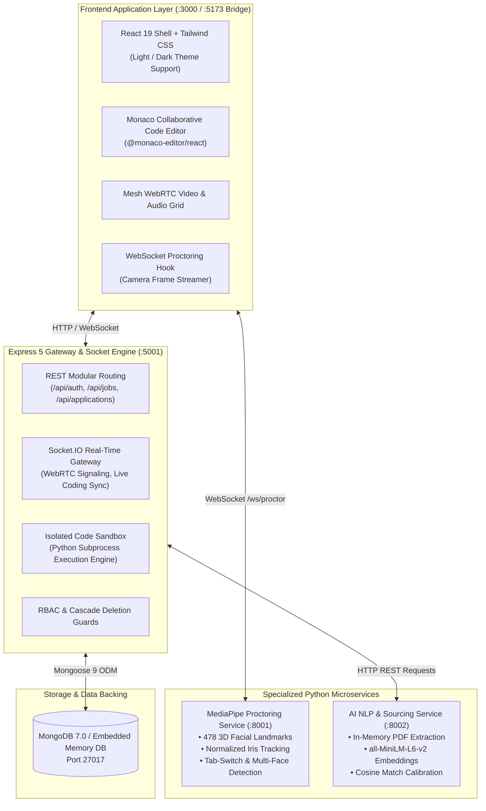

# Axiocruit — Enterprise Autonomous Talent Intelligence & Assessment Ecosystem

<p align="center">
  
  
  
  
  
  
  
  
</p>

---

## Executive Overview

**Axiocruit** is a next-generation, full-lifecycle technical hiring and biometric proctoring ecosystem. Engineered from first principles for modern engineering organizations, recruitment agencies, and freelance technical interviewers, Axiocruit replaces subjective evaluations and keyword-stuffed resumes with mathematically calibrated talent intelligence.

The platform unifies **vector-embedded resume parsing**, **real-time computer-vision proctoring**, **collaborative in-browser Monaco live coding**, **mesh WebRTC audio/video signaling**, and **autonomous candidate pipeline orchestration** into a cohesive, high-performance web experience.

```
┌────────────────────────────────────────────────────────────────────────────────────────┐
│                                  AXIOCRUIT ECOSYSTEM                                    │
├─────────────────────┬──────────────────────┬────────────────────┬──────────────────────┤
│    AUTONOMOUS ATS   │  BIOMETRIC INTEGRITY │  COLLABORATIVE IDE │ PIPELINE INTELLIGENCE│
│   Dense Embeddings  │  478-Point FaceMesh  │  Monaco Execution  │ Real-Time Telemetry  │
│  SentenceTransforms │  Gaze Vector Tracker │ Multi-Lang Sandbox │  Kanban & Drawers    │
└─────────────────────┴──────────────────────┴────────────────────┴──────────────────────┘
```

---

## Platform Architecture

Axiocruit operates as a decoupled microservices architecture designed for ultra-low latency, modular scaling, and resilient failover.



---

## Key Platform Capabilities

### 1. Semantic ATS & Dense Vector Screening
Traditional applicant tracking systems rely on brittle keyword string matching easily bypassed by prompt injections or keyword stuffing. Axiocruit deploys a dense vector embedding pipeline:
- **In-Memory PDF Parsing**: Resumes are ingested directly into memory streams via `pdfplumber` without persisting unencrypted candidate documents to disk.
- **Dense Vector Representation**: Applicant work experience, skills, and projects are mapped into 384-dimensional semantic space via SentenceTransformers (`all-MiniLM-L6-v2`).
- **Calibrated Cosine Similarity**: Computes continuous mathematical alignment between applicant resumes and technical job descriptions, outputting objective match percentages.
- **Syntactic Keyword Analytics**: Employs `spaCy` NLP pipelines to contrast matched keywords against missing core technical competencies.

### 2. Real-Time Computer-Vision Biometric Proctoring
Ensures absolute assessment integrity during remote evaluations while respecting candidate privacy:
- **Zero Raw Video Storage**: Frame data streamed over persistent WebSockets is processed ephemeral in memory; no video streams are stored on server disks.
- **478 3D Facial Landmarks**: Google MediaPipe Face Landmarker tracks facial posture, orientation, and head angles in real-time.
- **Iris Gaze Tracking**: Measures normalized eye-canthus-to-iris ratios (landmarks 468 & 473) to identify when candidate attention drifts away from the primary display.
- **Anomaly Scorecards**: Logs timestamped events for gaze deviation, multiple faces in frame, face occlusion, ambient speech detection, and browser tab switches.

### 3. Monaco Collaborative Live Coding Sandbox
- **Full VS Code Capabilities**: Embedded Monaco Editor with multi-language syntax highlighting, bracket matching, and auto-indentation.
- **Bi-Directional Synchronous Collaboration**: Interviewers and candidates collaborate in real-time over WebSocket operational transforms.
- **Asynchronous Safe Execution**: Code is executed inside sandboxed subprocesses with CPU timeouts, memory caps, and stdout/stderr capture.
- **Unit Test Runner**: Automatically tests algorithmic solutions against visible and hidden test cases, returning instant pass/fail telemetry.

### 4. Interactive Recruiter Sourcing & Candidate Inspector
- **3D Perspective Hardware Showcase**: High-impact, responsive 3D dashboard displaying real-time sourcing pipelines, requisition analytics, and candidate distributions.
- **Interactive Candidate Drawer**: Instant slide-out inspection featuring SVG circular match gauges, categorized skill chips, chronological candidate timelines, and direct interview scheduling.
- **Pipeline Stage Management**: Move candidates across `Applied` → `Screening` → `Interview` → `Offer` stages with optimistic UI updates and backend transaction locks.

### 5. Freelance Technical Interviewer Marketplace
- **Vetted Interviewer Profiles**: Organizations can browse and book vetted domain specialists to conduct technical interviews on demand.
- **Availability Scheduling**: Dynamic time slot booking with automated calendar hold mechanisms.
- **Standardized Rubrics**: Interviewers submit comprehensive performance scorecards covering code quality, problem solving, system design, and communication.

---

## Repository Architecture & Codebase Map

The codebase is organized into an enterprise feature-driven architecture:

```
Axiocruit-main/
├── ai-service/                     # Python NLP & Semantic Vector Microservice
│   ├── main.py                     # FastAPI app, SentenceTransformers & spaCy pipeline
│   ├── requirements.txt            # Python dependencies
│   └── venv/                       # Dedicated Python virtual environment
│
├── proctoring-service/             # Python Computer Vision Proctoring Microservice
│   ├── main.py                     # FastAPI WebSocket gaze and face tracker
│   ├── face_landmarker.task        # MediaPipe 478-keypoint biometric model
│   ├── requirements.txt            # Microservice requirements
│   └── venv/                       # Dedicated Python virtual environment
│
├── server/                         # Core Backend API Gateway & Real-Time Server
│   ├── bootstrap/                  # Express lifecycle and server bootstrapping
│   ├── config/                     # Database connection & auto-seeding routines
│   ├── controllers/                # REST Controllers (auth, jobs, interviews, etc.)
│   ├── guards/                     # RBAC & authentication protection middleware
│   ├── middleware/                 # Upload, rate limiting, and error handling
│   ├── models/                     # Mongoose 9 schemas (User, Job, Application, etc.)
│   ├── realtime/                   # WebRTC signaling, chat, and proctoring sockets
│   ├── routes/                     # Express modular route definitions
│   └── schemas/                    # Canonical user role taxonomy & validation
│
├── src/                            # Modern Modular React 19 Frontend
│   ├── core/                       # Core application providers & shell layouts
│   │   ├── App.tsx                 # Route declarations & lazy-loading partitions
│   │   ├── Layouts.tsx             # Floating island navbar & responsive shell
│   │   ├── ThemeContext.tsx        # Persistent Dark/Light mode state
│   │   └── api.ts                  # Type-safe API client with interceptors
│   │
│   ├── features/                   # Feature-driven domain modules
│   │   ├── public/                 # Homepage, Hero, 3D Mockup, Feature Matrix
│   │   ├── recruiter/              # Recruiter dashboard, pipeline analytics
│   │   ├── candidates/             # Candidate table, inspector drawer, profiles
│   │   ├── interview-room/         # Monaco editor, WebRTC grid, proctoring HUD
│   │   ├── interviewer/            # Interviewer dashboard & gig marketplace
│   │   └── auth/                   # Enterprise sign-in & registration flows
│   │
│   ├── ui/                         # Reusable UI primitives (Buttons, Badges, Modals)
│   ├── theme/                      # Visual identity tokens & reference palettes
│   └── data/                       # Canonical benchmark data & sample datasets
│
├── scripts/                        # Utility & developer bridge scripts
│   └── redirect-5173.js            # Port 5173 to 3000 seamless HTTP redirector
│
├── tests/                          # Automated Verification & Adversarial Suites
│   ├── e2e/                        # Comprehensive 169-test E2E verification suite
│   ├── m3_challenger_adversarial_suite.js     # 80-test bundle & alias stress suite
│   ├── m3_adversarial_subcomponents.test.js   # 36-test visual & token invariant suite
│   ├── m3_empirical_challenger_v2.test.js     # 61-test wiring & null-safety harness
│   └── m4_backend_invariants_adversarial.test.js # 49-test route & transaction suite
│
├── package.json                    # Workspace orchestrator & frontend dependencies
├── vite.config.ts                  # Vite 6 config with vendor chunk segregation
└── tsconfig.json                   # Strict TypeScript compiler configuration
```

---

## Service Endpoints & Network Topology

| Port | Service | Protocol | Primary Responsibilities |
| :---: | :--- | :---: | :--- |
| **`3000`** | **Frontend Client** | HTTP / WS | React 19 SPA, Tailwind UI, Monaco Editor, WebRTC Video Grid |
| **`5173`** | **Redirect Bridge** | HTTP | Seamless bridge redirecting legacy 5173 bookmarks to port 3000 |
| **`5001`** | **Express API Gateway** | HTTP / Socket.IO | REST endpoints, JWT authentication, WebRTC signaling, Sandboxed Runner |
| **`8001`** | **Proctoring Engine** | HTTP / WS | MediaPipe face landmarker, real-time gaze analysis, anomaly events |
| **`8002`** | **AI Sourcing Engine** | HTTP | SentenceTransformers resume vectorization, spaCy keyword matching |

---

## Quick Start & Local Setup

### Prerequisites
- **Node.js**: `v20.0.0` or higher
- **Python**: `3.10` or higher (for microservices)
- **Git**

### 1. Clone & Install Dependencies
```bash
# Clone the repository
git clone https://github.com/darshan-xyz/Axiocruit.git
cd Axiocruit

# Install frontend dependencies
npm install

# Install backend dependencies
cd server && npm install && cd ..
```

### 2. Python Virtual Environments (One-Time Setup)
```bash
# AI Service environment
cd ai-service
python -m venv venv
.\venv\Scripts\python.exe -m pip install -r requirements.txt
cd ..

# Proctoring Service environment
cd proctoring-service
python -m venv venv
.\venv\Scripts\python.exe -m pip install -r requirements.txt
cd ..
```

### 3. Launch All Services Concurrently
Axiocruit includes a single command that boots the client, backend, and both Python microservices:

```bash
npm run dev
```

Alternatively, launch services independently:
```bash
# Terminal 1: Frontend Client (Port 3000)
npm run client

# Terminal 2: Express Gateway & Database (Port 5001)
npm run server

# Terminal 3: Proctoring Microservice (Port 8001)
npm run proctor

# Terminal 4: AI NLP Microservice (Port 8002)
npm run ai
```

### 4. Access the Application
Open your browser and navigate to:
- **[http://localhost:3000](http://localhost:3000)** (or `http://localhost:5173` via redirect bridge)

---

## Pre-Seeded Enterprise Demo Accounts

Upon initial startup with an empty database or in zero-config development mode, the embedded database automatically seeds standard demonstration accounts:

| Role | Email Address | Password | Permissions & Scope |
| :--- | :--- | :--- | :--- |
| **Recruiter** | `recruiter@axiocruit.com` | `Password123!` | Job creation, candidate pipeline, scoring review |
| **System Admin** | `admin@axiocruit.com` | `Password123!` | Global platform governance, user management, audit logs |
| **Organization** | `org@axiocruit.com` | `Password123!` | Department administration, recruiter team management |
| **Interviewer** | `interviewer@axiocruit.com` | `Password123!` | Freelance gig claims, live interview assessment rooms |
| **Candidate** | `candidate@axiocruit.com` | `Password123!` | Job search, resume submission, Monaco coding tests |

---

## Verification & Quality Assurance Battery

Axiocruit maintains a 100% automated test pass rate across unit, component, adversarial, and cross-feature integration batteries:

```bash
# 1. Strict TypeScript Compiler Audit (Zero Errors Required)
npx tsc --noEmit

# 2. Production Build & Chunk Splitting Verification
npm run build

# 3. Comprehensive End-to-End Test Suite (169 Test Cases)
node tests/e2e/run_all.js

# 4. Adversarial Bundle & Alias Resolution Suite (80 Test Cases)
node tests/m3_challenger_adversarial_suite.js

# 5. Modular Subcomponents & Visual Invariants (36 Test Cases)
node tests/m3_adversarial_subcomponents.test.js

# 6. Wiring & Null-Pointer Resilience Harness (61 Test Cases)
node tests/m3_empirical_challenger_v2.test.js

# 7. Backend Route Ordering & Transaction Atomicity (49 Test Cases)
node tests/m4_backend_invariants_adversarial.test.js
```

### Verification Matrix Summary

| Test Harness | Total Tests | Pass Rate | Validated Invariants |
| :--- | :---: | :---: | :--- |
| **End-to-End Suite** (`run_all.js`) | `169` | **100.0%** | Full hiring lifecycle, Monaco IDE, WebRTC, responsive breakpoints |
| **Challenger Adversarial** (`m3_challenger`) | `80` | **100.0%** | Vendor chunk segregation, path alias resolution, visual palettes |
| **Subcomponents Invariants** (`m3_adversarial`) | `36` | **100.0%** | SVG math models, 3D tilt coordinates, token integrity |
| **Empirical Wiring** (`m3_empirical_v2`) | `61` | **100.0%** | Candidate drawer state isolation, pagination clamping, null guards |
| **Backend Invariants** (`m4_backend`) | `49` | **100.0%** | Parametric route shadowing, MongoDB rollback transactions, cascade purges |

---

## Security, Privacy & Enterprise Compliance

1. **Ephemeral Biometric Processing**:
   - Camera video frames processed for gaze orientation are evaluated strictly in RAM. No video streams or face crops are ever written to disk or transmitted to third-party APIs.
2. **Deterministic Route Ordering**:
   - Parametric wildcards (`/:id`) are strictly ordered after specific named paths (`/my-jobs`, `/stats`, `/conversations`) across all Express route files, preventing accidental request swallowing.
3. **Database Cascade Deletions & Rollback Transactions**:
   - Multi-document write operations (e.g. gig acceptance, hire proposals) use atomic Mongoose sessions with automatic rollbacks on failure.
   - Deleting an organization or user triggers systematic cascades across associated requisitions, applications, and messaging logs to prevent orphaned state.
4. **Content Security & Sanitization**:
   - Search queries and text inputs pass through strict sanitization filters to prevent regex denial of service (ReDoS) and cross-site scripting (XSS) attacks.

---

## Enterprise Support & License

Axiocruit is distributed under the **ISC License**. For enterprise licensing, custom LLM fine-tuning, or dedicated proctoring infrastructure, contact the engineering team.

```
Copyright (c) 2026 Axiocruit Platform Engineering Team.
All rights reserved.
```
