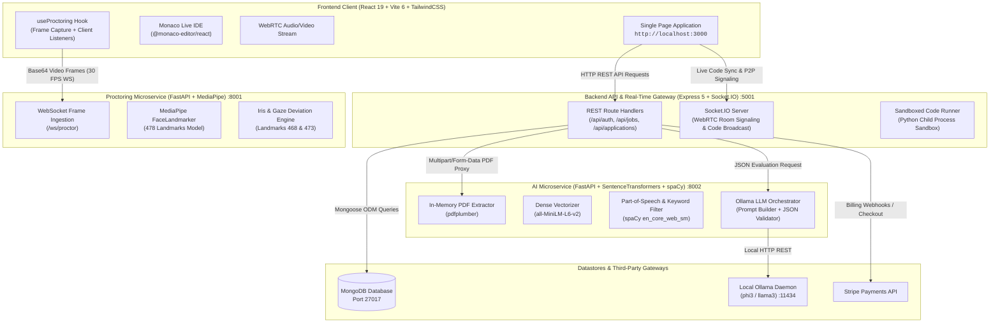

# Axiocruit — Enterprise Technical Recruitment Platform

[](https://www.typescriptlang.org/)
[](https://react.dev/)
[](https://nodejs.org/)
[](https://expressjs.com/)
[](https://fastapi.tiangolo.com/)
[](https://www.python.org/)
[](https://www.docker.com/)
[](LICENSE)

**Axiocruit** (derived from Ancient Greek *áxios* — *"worthy, deserving, of verified merit"*) is an enterprise-grade technical recruitment, assessment, and proctoring ecosystem. Designed for **Candidates**, **Recruiters**, **Freelance Interviewers**, and **Talent Operations Teams**, Axiocruit delivers automated CV parsing, dense-vector semantic ATS matching, real-time computer vision proctoring via MediaPipe, collaborative live coding sandboxes in Monaco, WebRTC peer-to-peer video streaming, and private on-premise LLM candidate evaluations.

---

## Table of Contents

1. [Executive Summary & Problem Statement](#executive-summary--problem-statement)
2. [High-Level Architecture](#high-level-architecture)
   - [System Topology & Data Flow](#system-topology--data-flow)
   - [Microservice Network Topology](#microservice-network-topology)
   - [Architectural Paradigm & Design Principles](#architectural-paradigm--design-principles)
3. [Core AI & Machine Learning Subsystems](#core-ai--machine-learning-subsystems)
   - [1. Semantic ATS & Resume Parsing Pipeline (`ai-service`)](#1-semantic-ats--resume-parsing-pipeline-ai-service)
   - [2. Real-Time Computer Vision Proctoring Engine (`proctoring-service`)](#2-real-time-computer-vision-proctoring-engine-proctoring-service)
   - [3. Multimodal Post-Interview AI Evaluator (`ai-service`)](#3-multimodal-post-interview-ai-evaluator-ai-service)
4. [Live Coding Assessment & Sandboxed Execution](#live-coding-assessment--sandboxed-execution)
5. [Role-Based Feature Matrix & User Journeys](#role-based-feature-matrix--user-journeys)
   - [Candidate Portal](#candidate-portal)
   - [Recruiter Hub](#recruiter-hub)
   - [Freelance Interviewer Marketplace](#freelance-interviewer-marketplace)
   - [Platform Admin & Organization Operations](#platform-admin--organization-operations)
6. [API & WebSocket Service Catalog](#api--websocket-service-catalog)
   - [Core Express Backend (`:5001`)](#core-express-backend-5001)
   - [AI NLP & Evaluation Microservice (`:8002`)](#ai-nlp--evaluation-microservice-8002)
   - [Proctoring Microservice (`:8001`)](#proctoring-microservice-8001)
7. [Repository Structure & Codebase Map](#repository-structure--codebase-map)
8. [Prerequisites & Local Environment Setup](#prerequisites--local-environment-setup)
   - [System Requirements](#system-requirements)
   - [Step 1: Dependencies Installation](#step-1-dependencies-installation)
   - [Step 2: Python Virtual Environments](#step-2-python-virtual-environments)
   - [Step 3: Ollama Local LLM Deployment](#step-3-ollama-local-llm-deployment)
   - [Step 4: Environment Variables Configuration](#step-4-environment-variables-configuration)
   - [Step 5: Launching Services](#step-5-launching-services)
   - [Pre-Seeded Demo Accounts](#pre-seeded-demo-accounts)
9. [Production Docker Deployment](#production-docker-deployment)
10. [Testing, Quality Assurance & Verification](#testing-quality-assurance--verification)
11. [Security, Privacy & Data Ethics](#security-privacy--data-ethics)
12. [Troubleshooting & Frequently Asked Questions](#troubleshooting--frequently-asked-questions)

---

## Executive Summary & Problem Statement

Modern technical hiring is plagued by four critical points of failure:
1. **Resume Inflation & Keyword Stuffing**: Traditional regex ATS engines reward candidates who hide white-text keywords or spam buzzwords without demonstrating semantic comprehension.
2. **Interview Fraud & External Assistance**: Remote assessments suffer from unauthorized secondary screens, off-camera collaborators, browser tab switching, and covert generative AI clipboard pasting.
3. **Interviewer Variability & Bias**: Unstructured technical reviews yield subjective feedback with low correlation to job performance.
4. **Scattered Tooling Overhead**: Companies stitch together disparate tools for ATS, coding challenges, WebRTC conferencing, and proctoring.

**Axiocruit** solves this through a unified, sovereign hiring engine:
- **Dense Vector Semantic Matching**: Embeds resumes and job requisitions into 384-dimensional latent space using `SentenceTransformers`, measuring true contextual alignment rather than verbatim keyword counts.
- **Sub-Second Biometric Proctoring**: Runs a 478-point facial landmark mesh at 30 FPS via WebSockets, calculating real-time iris-to-eye corner ratios to catch gaze deviations and off-screen glances.
- **Synchronized Live Coding & Execution**: Monaco editor with real-time cursor sync over Socket.IO, backed by a sandboxed Python execution engine with per-case timeout safeguards.
- **Private, On-Premise LLM Synthesizer**: Ollama-powered post-interview analysis fusing code quality, test pass rates, proctoring violation logs, and interviewer notes into calibrated scorecards.

---

## High-Level Architecture

### System Topology & Data Flow



### Microservice Network Topology

| Component | Port | Host Address | Protocol | Core Dependencies | Primary Function |
|---|---|---|---|---|---|
| **Frontend Client** | `3000` | `http://localhost:3000` | HTTP / WSS | Vite, React 19, Tailwind | Role-based SPA interfaces for all personas |
| **Backend Gateway** | `5001` | `http://localhost:5001` | HTTP / WS | Node.js, Express 5, Socket.IO | Business logic, authentication, WebRTC signaling, code execution |
| **AI Microservice** | `8002` | `http://localhost:8002` | HTTP | FastAPI, Uvicorn, SentenceTransformers, spaCy | Resume parsing, dense semantic scoring, LLM evaluation |
| **Proctoring Service**| `8001` | `http://localhost:8001` | HTTP / WS | FastAPI, MediaPipe, OpenCV, WebSockets | Real-time face presence, iris tracking, anomaly detection |
| **Ollama Daemon** | `11434`| `http://localhost:11434`| HTTP | Ollama, Llama 3 / Phi-3 | Local private LLM inference for post-interview rubrics |
| **MongoDB Database**| `27017`| `mongodb://localhost:27017`| TCP | MongoDB 7.0 / MongoMemoryServer | Primary document store for applications, users, and audit events |

### Architectural Paradigm & Design Principles

1. **Deterministic Pipelines over Stochastic Agents**:
   - Rather than relying on autonomous multi-agent loops that can hallucinate or introduce scoring drift, Axiocruit uses reproducible vector mathematics (`all-MiniLM-L6-v2`) and strict linguistic grammar heuristics (`spaCy`).
2. **Ephemeral Zero-Leak Processing**:
   - Resumes uploaded for matching are processed exclusively in-memory (`BytesIO`) with no temporary disk artifacts. Video frames ingested for proctoring are analyzed in volatile RAM and discarded instantly.
3. **Resilient Offline / Low-Resource Fallbacks**:
   - If a candidate runs on low hardware without an operational Ollama daemon, the backend gracefully falls back to deterministic rule-based evaluation. If local MongoDB is missing, the backend auto-spins an in-memory database (`mongodb-memory-server`) for zero-friction evaluation.
4. **Strict Decoupling of CPU-Intensive Workloads**:
   - Intensive computer vision (MediaPipe) and embedding vector calculations are isolated in independent Python processes, leaving the Node.js event loop free to handle real-time WebRTC and Socket.IO signaling with near-zero latency.

---

## Core AI & Machine Learning Subsystems

### 1. Semantic ATS & Resume Parsing Pipeline (`ai-service`)

Located in [`ai-service/main.py`](ai-service/main.py), this microservice scores candidate CVs against job specifications in four rigorous stages:

```
+-----------------------------------------------------------------------------------------------+
|                                      IN-MEMORY STAGES                                         |
|                                                                                               |
|  [Uploaded PDF] ──> [pdfplumber] ──> Clean Text Buffer                                        |
|                                            │                                                  |
|         ┌──────────────────────────────────┴───────────────────────────────────┐              |
|         ▼                                                                      ▼              |
|  [SentenceTransformers]                                                 [spaCy en_core]       |
|  all-MiniLM-L6-v2 (384-dim)                                              POS Filter (NOUN/PROPN)
|         │                                                                      │              |
|  Cosine Similarity Engine                                               Curated Tech Keyword Boost
|  CosSim(V_cv, V_jd)                                                            │              |
|         │                                                               Sub-Phrase Cleaner    |
|         ▼                                                                      ▼              |
|   Semantic Score (0-100)                                                Keyword Score (0-100) |
|         │                                                                      │              |
|         └──────────────────────────────────┬───────────────────────────────────┘              |
|                                            ▼                                                  |
|                             Adaptive Weighted Blending Formula                                |
|                                            │                                                  |
|                                            ▼                                                  |
|                            Final Suitability Score (0 - 100)                                  |
+-----------------------------------------------------------------------------------------------+
```

#### Step 1: In-Memory Text Extraction
- Ingests PDF binary streams directly into Python memory (`io.BytesIO`).
- Utilizes `pdfplumber` for layout-aware character flow extraction, discarding font decorations and image noise.

#### Step 2: Dense Vector Semantic Similarity
- Uses the lightweight, high-performance `sentence-transformers/all-MiniLM-L6-v2` model pre-loaded in memory at service boot.
- Encodes candidate text and job description into 384-dimensional dense vectors ($\vec{u}, \vec{v}$).
- Computes Cosine Similarity:
  $$\text{SemanticScore} = \max\left(0, \min\left(100, \frac{\vec{u} \cdot \vec{v}}{\|\vec{u}\| \|\vec{v}\|} \times 100\right)\right)$$

#### Step 3: Linguistic Entity & Technical Keyword Harvesting
- Employs `spaCy`'s `en_core_web_sm` model to parse syntactic noun-chunks and named entities.
- **Filter Heuristics**:
  - Restricts parts-of-speech to proper nouns (`PROPN`) and common nouns (`NOUN`).
  - Caps extracted phrases at a maximum of 2 words.
  - Strips non-technical named entity labels (`DATE`, `TIME`, `MONEY`, `QUANTITY`, `PERCENT`, `ORDINAL`, `CARDINAL`).
  - Filters out 70+ generic job description stop-words (e.g., *"stakeholder"*, *"fast-paced"*, *"responsible for"*).
  - Cross-references against a curated dictionary of 100+ modern engineering and cloud primitives (`Kubernetes`, `TypeScript`, `PyTorch`, `CI/CD`, `Kafka`, `GraphQL`, etc.).
  - **Sub-phrase Deduplication**: If a candidate matches individual words (e.g., *"aws"* and *"cloudformation"*), composite phrases like *"aws cloudformation"* are purged from the missing list to avoid double penalties.

#### Step 4: Adaptive Score Blending
- **Standard JDs** ($\ge 5$ extracted keywords):
  $$\text{FinalScore} = 0.60 \times \text{SemanticScore} + 0.40 \times \text{KeywordScore}$$
- **Sparse JDs** ($< 5$ extracted keywords):
  $$\text{FinalScore} = 0.85 \times \text{SemanticScore} + 0.15 \times \text{KeywordScore}$$

---

### 2. Real-Time Computer Vision Proctoring Engine (`proctoring-service`)

Located in [`proctoring-service/main.py`](proctoring-service/main.py), this microservice handles high-throughput video stream analysis over persistent WebSockets (`/ws/proctor`).

#### MediaPipe 478-Point Face Mesh
The service utilizes Google's `face_landmarker.task` model operating in continuous image-processing mode with detection, tracking, and presence confidence thresholds configured at `0.5`.

#### Biometric Gaze & Iris Deviation Mathematics
To detect when a candidate is consulting a secondary monitor or cheating notes off-camera, the engine tracks the spatial relationship of the irises to the eye bounding box:

```
        Upper Eyelid (#159)
              ▲
              │
Outer Corner ─── ( Iris Center #468 ) ─── Inner Corner
   (#33)      │                              (#133)
              ▼
        Lower Eyelid (#145)
```

1. **Left Eye Tracking**:
   - Inner Corner: Landmark `133`
   - Outer Corner: Landmark `33`
   - Upper Eyelid: Landmark `159`
   - Lower Eyelid: Landmark `145`
   - Iris Center: Landmark `468`
2. **Right Eye Tracking**:
   - Inner Corner: Landmark `362`
   - Outer Corner: Landmark `263`
   - Upper Eyelid: Landmark `386`
   - Lower Eyelid: Landmark `374`
   - Iris Center: Landmark `473`

The horizontal gaze ratio is calculated as:
$$\text{Ratio}_{\text{horizontal}} = \frac{\text{Distance}(\text{IrisCenter}, \text{InnerCorner})}{\text{Distance}(\text{OuterCorner}, \text{InnerCorner})}$$

When horizontal or vertical ratios deviate beyond calibrated tolerance thresholds ($< 0.35$ or $> 0.65$) across consecutive video frames, a `gaze` anomaly event is emitted to the interview ledger.

#### Multi-Signal Integrity Monitoring
The proctoring subsystem simultaneously corroborates five distinct signals:
- **`face_lost`**: No face landmarker returned for $> 3$ consecutive frames.
- **`multiple_faces`**: More than one face detected within the camera frame.
- **`gaze`**: Gaze vector indicates attention directed away from the test viewport.
- **`tab_switch`**: Detected via the client Page Visibility API (`visibilitychange`).
- **`clipboard`**: Intercepts `copy` and `paste` events in the editor.
- **`screenshot`**: Intercepts system print-screen shortcuts.

---

### 3. Multimodal Post-Interview AI Evaluator (`ai-service`)

Endpoint: `POST /api/ai/evaluate-interview`

At the conclusion of a technical interview, Axiocruit aggregates quantitative and qualitative data to generate a balanced scorecard:

```json
{
  "interviewId": "65e21a...",
  "candidateCode": "def two_sum(nums, target):\n    lookup = {}\n    for i, n in enumerate(nums):\n        ...",
  "codingScore": 100,
  "codingTestConducted": true,
  "proctorEvents": [
    { "type": "tab_switch", "detail": "Candidate left window", "timestamp": "14:22:01" },
    { "type": "gaze", "detail": "Gaze deviated off-screen", "timestamp": "14:23:45" }
  ],
  "interviewerNotes": "Candidate demonstrated solid grasp of hash maps and Big-O trade-offs. Smooth communication."
}
```

#### Ollama LLM Processing
- Queries local Ollama daemon on port `11434`.
- Auto-detects installed models via `GET /api/tags`, defaulting to `phi3` (optimal for machines with $\le 8$GB RAM) or `llama3`.
- Prompts the LLM under low temperature (`0.3`) with strict JSON schema constraints.
- Emits structured output:
  - `suitabilityScore` (0–100 integer)
  - `strengths` (3–5 bulleted points)
  - `weaknesses` (3–5 bulleted points)
  - `redFlags` (synthesized deterministically from proctoring violation counts)

#### Deterministic Heuristic Fallback
If Ollama is unreachable or timed out, an internal fallback algorithm computes:
$$\text{BaseScore} = 72 + (\text{CodingScore} - 50) \times 0.3$$
$$\text{FinalScore} = \max(0, \min(100, \text{BaseScore} - (\text{Violations} \times 5)))$$

---

## Live Coding Assessment & Sandboxed Execution

Technical assessments are powered by the Monaco Editor (`@monaco-editor/react`), supporting syntax highlighting, code auto-completion, and multi-language presets (JavaScript, Python, Java, C++).

### Sandboxed Python Runner (`server/controllers/codingTestController.js`)
When a candidate executes their solution:
1. **Isolated Ephemeral Scripting**: Writes code to a temporary file (`os.tmpdir()`) prefixed with `axiocruit_${timestamp}_${random}.py`.
2. **Fast-Fail Syntax Compilation**: Runs `python -m py_compile` with a strict 3,000ms timeout to intercept `SyntaxError` exceptions before executing tests.
3. **Per-Case Test Harness**: Runs each test case input independently against the compiled binary with input redirection and stdout capture.
4. **Resource & Timeout Guardrails**: Enforces a strict execution limit (`EXEC_TIMEOUT_MS = 5000ms`) to kill infinite loops (`while True`) or memory exhaustion attacks.
5. **Immediate Cleanup**: Removes the temporary script in a `finally` block to prevent disk pollution.

---

## Role-Based Feature Matrix & User Journeys

### Candidate Portal
- **Discovery**: Search active technical openings filtered by Engineering, Product, Design, or Marketing.
- **Instant ATS Feedback**: Upload CV for real-time match evaluation with highlighted missing skills.
- **Collaborative Interviewing**: Join WebRTC peer-to-peer interview rooms with synchronized code editing.
- **Assessment Sandbox**: Practice and complete coding challenges with automated test execution feedback.

### Recruiter Hub
- **High-Density Candidate Roster**: Sakrome-style candidate table featuring stage badges (`New`, `Screening`, `Interview`, `Assessment`, `Hired`), department icons, and match scores.
- **Inspector Drawer**: Slide-over drawer with circular SVG match gauges, skill cloud chips, candidate timeline, and direct interview scheduling.
- **Analytics & Pipeline Matrix**: 4-quadrant KPI cards (Emerald, Cobalt, Coral, Hot Pink), job distribution donut charts, and weekly activity arc gauges.
- **Delegation**: Delegate technical interviews to verified freelance specialists with escrowed payments.

### Freelance Interviewer Marketplace
- **Gig Board**: Browse open interview requisitions posted by hiring teams with upfront hourly rates.
- **Interview Suite**: Host technical screens with integrated split-screen video, synchronized Monaco IDE, and candidate proctoring monitors.
- **Rubric Scoring**: Submit structured evaluations with automated AI synthesis connecting code quality to proctor logs.

### Platform Admin & Organization Operations
- **RBAC Governance**: Super-admin oversight of Users, Organizations, Recruiters, and Interviewers.
- **System Health Monitor**: Live telemetry tracking active Socket.IO rooms, AI microservice availability, and database operations.
- **Stripe Integration**: Organization billing plans, assessment credits, and freelance payout management.

---

## API & WebSocket Service Catalog

### Core Express Backend (`:5001`)

#### Authentication & Profiles (`/api/auth`, `/api/users`)
- `POST /api/auth/register` — Create candidate, recruiter, or interviewer accounts.
- `POST /api/auth/login` — Authenticate credentials and return JWT bearer token.
- `GET /api/auth/me` — Retrieve session details of the authenticated caller.
- `GET /api/users/profile` — Fetch user profile, resume URL, and skills list.
- `PUT /api/users/profile` — Update professional bio, hourly rates, or candidate portfolio.

#### Job Requisitions (`/api/jobs`)
- `GET /api/jobs` — Query published job listings with department/keyword filtering.
- `POST /api/jobs` — Create a new job requisition with skill requirements and salary bands.
- `GET /api/jobs/:id` — Retrieve full job details and pipeline metrics.
- `DELETE /api/jobs/:id` — Archive a job requisition.

#### Applications & ATS Ranking (`/api/applications`)
- `POST /api/applications` — Submit candidate application with multipart PDF resume.
- `GET /api/applications` — Query applications filtered by job ID and status.
- `PUT /api/applications/:id/status` — Advance candidate stage (`Screening`, `Interview`, `Hired`).
- `GET /api/applications/ranked/:jobId` — Return candidates sorted by suitability score.

#### Technical Interviews & WebRTC (`/api/interviews`)
- `POST /api/interviews/schedule` — Create interview session and generate secure room tokens.
- `GET /api/interviews/:id` — Retrieve interview state, assigned interviewer, and meeting tokens.
- `POST /api/interviews/:id/feedback` — Submit interviewer evaluation rubric and ratings.

#### Coding Assessment Sandbox (`/api/coding-tests`)
- `GET /api/coding-tests/questions` — List available coding test problems by difficulty.
- `POST /api/coding-tests/run` — Execute user code in sandbox against sample test cases.
- `POST /api/coding-tests/submit` — Perform final test evaluation against hidden test suites.

#### System Telemetry & Probes (`/api/health`)
- `GET /api/health` — Liveness probe returning process uptime, memory RSS, and Node version.
- `GET /api/health/ready` — Readiness probe validating MongoDB connection status.

---

### AI NLP & Evaluation Microservice (`:8002`)

- `POST /api/ai/parse-cv`
  - **Payload**: `file` (multipart PDF) + `job_description` (form-data text).
  - **Response**:
    ```json
    {
      "suitability_score": 87.4,
      "matched_keywords": ["docker", "kubernetes", "python", "typescript"],
      "missing_keywords": ["graphql", "redis"]
    }
    ```
- `POST /api/ai/evaluate-interview`
  - **Payload**: JSON containing code, coding test score, proctoring violation events, and interviewer notes.
  - **Response**: JSON containing `suitabilityScore`, `strengths`, `weaknesses`, and `redFlags`.
- `GET /health` — Verifies that `SentenceTransformers` and `spaCy` are loaded in memory.

---

### Proctoring Microservice (`:8001`)

- `WS /ws/proctor`
  - **Client Message**: `{ "image": "data:image/jpeg;base64,..." }`
  - **Server Response**:
    ```json
    {
      "face_detected": true,
      "faces_count": 1,
      "gaze_direction": "center",
      "gaze_deviation": false,
      "timestamp": "2026-09-20T12:00:00Z"
    }
    ```
- `GET /health` — Liveness probe confirming MediaPipe FaceLandmarker model readiness.

---

## Repository Structure & Codebase Map

```
Procruit-main/
├── ai-service/                         # Python AI / NLP Microservice (Port 8002)
│   ├── main.py                         # FastAPI server (CV parsing, SentenceTransformers, Ollama)
│   ├── requirements.txt                # Python dependencies (spacy, sentence-transformers, etc.)
│   └── venv/                           # Isolated Python virtual environment
├── proctoring-service/                 # Python Computer Vision Proctoring Service (Port 8001)
│   ├── main.py                         # FastAPI WebSocket server (MediaPipe FaceLandmarker)
│   ├── face_landmarker.task            # 478-point MediaPipe model asset
│   ├── requirements.txt                # Python CV dependencies (opencv-python, mediapipe)
│   └── venv/                           # Isolated Python virtual environment
├── server/                             # Express.js Backend & Gateway (Port 5001)
│   ├── config/
│   │   ├── db.js                       # MongoDB connection & MongoMemoryServer fallback
│   │   └── seedDefaultData.js          # Demo account and coding questions seeder
│   ├── controllers/
│   │   └── codingTestController.js     # Sandboxed Python test runner
│   ├── middleware/                     # JWT authentication and RBAC guards
│   ├── models/                         # Mongoose schemas (User, Job, Application, Interview)
│   ├── routes/                         # REST modular endpoints (12 route modules)
│   ├── scripts/                        # Admin creation and database maintenance scripts
│   ├── index.js                        # Express server entry point & Socket.IO signaling
│   └── package.json                    # Backend dependencies
├── components/                         # React UI Component Library
│   ├── AdminLayout.tsx                 # Administration sidebar and top chrome
│   ├── Layouts.tsx                     # Main application shell (macOS container, nav pills)
│   ├── ThemeContext.tsx                # Obsidian Dark / Light mode provider
│   └── UI.tsx                          # Reusable primitives (Buttons, Badges, Modals, Cards)
├── pages/                              # Main Page Views
│   ├── InterviewRoom.tsx               # WebRTC video room, Monaco IDE, live proctoring HUD
│   ├── Public.tsx                      # Landing page with Herb Agency 3D tablet canvas
│   ├── RankedCandidates.tsx            # Candidate ranking view with slide-over drawer
│   └── Recruiter.tsx                   # Recruiter dashboard (KPI cards, matrix, timeline)
├── hooks/
│   └── useProctoring.ts                # Client proctoring hook (WebSocket frame streamer)
├── utils/
│   └── sakromeCandidates.ts            # Candidate data layer and profile fixtures
├── tests/                              # Automated Test Suites
│   ├── e2e/                            # End-to-end multi-tier test framework
│   │   ├── framework/                  # Custom assertions, API probes, AST inspectors
│   │   ├── suites/                     # Tiers 1-4 tests (Landing page, dashboards, E2E)
│   │   └── run_all.js                  # Master test runner
├── docker-compose.yml                  # Production multi-container orchestration
├── Dockerfile.client                   # Multi-stage frontend Dockerfile (Node -> Nginx)
├── Dockerfile.server                   # Node.js backend Dockerfile
├── Dockerfile.ai                       # Python AI microservice Dockerfile
├── Dockerfile.proctor                  # Python Proctoring microservice Dockerfile
├── nginx.conf                          # Frontend reverse proxy and WebSocket router
├── start_all.bat                       # Unified Windows service launcher
├── start_backend.bat                   # Backend and database launcher
├── start_frontend.bat                  # Frontend launcher
├── package.json                        # Root workspace scripts & client dependencies
├── vite.config.ts                      # Vite build configuration and dev proxies
└── tsconfig.json                       # TypeScript compiler configuration
```

---

## Prerequisites & Local Environment Setup

### System Requirements
- **Node.js**: `v18.0.0` or higher (`v20+` recommended)
- **npm**: `v9.0.0` or higher
- **Python**: `v3.10` to `v3.12`
- **MongoDB**: Local MongoDB community server on port `27017` or a MongoDB Atlas URI (Note: If neither is provided, Axiocruit will automatically spin up an embedded in-memory MongoDB instance).
- **Ollama** *(Optional for AI evaluations)*: Available from [ollama.com](https://ollama.com).

---

### Step 1: Dependencies Installation

Install root and frontend client dependencies:
```bash
npm install
```

Install backend dependencies:
```bash
cd server
npm install
cd ..
```

---

### Step 2: Python Virtual Environments

#### Set Up AI Microservice (`ai-service`)
```bash
cd ai-service
python -m venv venv

# On Windows:
.\venv\Scripts\pip install -r requirements.txt
.\venv\Scripts\python -m spacy download en_core_web_sm

# On macOS / Linux:
# source venv/bin/activate
# pip install -r requirements.txt
# python -m spacy download en_core_web_sm

cd ..
```

#### Set Up Proctoring Microservice (`proctoring-service`)
```bash
cd proctoring-service
python -m venv venv

# On Windows:
.\venv\Scripts\pip install -r requirements.txt

# On macOS / Linux:
# source venv/bin/activate
# pip install -r requirements.txt

cd ..
```

> [!IMPORTANT]
> Ensure that `proctoring-service/face_landmarker.task` is present. If absent, download it from Google Cloud Storage:
> ```bash
> curl -o proctoring-service/face_landmarker.task https://storage.googleapis.com/mediapipe-models/face_landmarker/face_landmarker/float16/1/face_landmarker.task
> ```

---

### Step 3: Ollama Local LLM Deployment

For post-interview evaluation synthesis without cloud API fees:
1. Start the Ollama engine:
   ```bash
   ollama serve
   ```
2. Pull the default lightweight model:
   ```bash
   ollama pull phi3
   ```
   *(For high-RAM environments with 16GB+ memory, run `ollama pull llama3`).*

---

### Step 4: Environment Variables Configuration

#### Backend Configuration (`server/.env`)
Create `server/.env` with the following variables:
```env
PORT=5001
NODE_ENV=development
MONGO_URI=mongodb://127.0.0.1:27017/axiocruit
JWT_SECRET=axiocruit_jwt_secret_dev_123
CLIENT_URL=http://localhost:3000
AI_SERVICE_URL=http://localhost:8002
PROCTORING_SERVICE_URL=http://localhost:8001
STRIPE_SECRET_KEY=
STRIPE_WEBHOOK_SECRET=
OLLAMA_URL=http://localhost:11434
```

#### Frontend Configuration (`.env.local` in project root)
```env
VITE_API_URL=http://localhost:5001
VITE_PROCTOR_WS_URL=ws://localhost:8001/ws/proctor
```

---

### Step 5: Launching Services

#### Method A: Unified Dev Runner (Single Terminal Command)
From the project root, start all 5 processes concurrently:
```bash
npm run dev
```

This concurrently orchestrates:
- `client` (Cyan): Vite dev server on `http://localhost:3000`
- `server` (Green): Express API & Socket.IO gateway on `http://localhost:5001`
- `ai` (Magenta): FastAPI AI microservice on `http://localhost:8002`
- `proctor` (Yellow): FastAPI proctoring microservice on `http://localhost:8001`
- `ollama` (Blue): Background Ollama daemon on `http://localhost:11434`

#### Method B: Windows Batch Scripts
- `start_all.bat`: Spawns all microservices in dedicated terminal windows.
- `start_backend.bat`: Launches Express API and MongoDB services.
- `start_frontend.bat`: Launches Vite frontend client.

---

### Pre-Seeded Demo Accounts

The database seeder automatically creates 5 fully provisioned accounts on startup:

| Role | Email Address | Password | Permissions & Scope |
|---|---|---|---|
| **Platform Admin** | `admin@axiocruit.com` | `Password123!` | Global administrative access, user controls, system metrics |
| **Organization Admin**| `org@axiocruit.com` | `Password123!` | Acme Corp management, company job postings, recruiter assignment |
| **Corporate Recruiter**| `recruiter@axiocruit.com` | `Password123!` | Full candidate pipeline, ATS drawer, interview scheduling |
| **Freelance Interviewer**| `interviewer@axiocruit.com` | `Password123!` | Claiming interview gigs, Monaco room access, rubric scoring |
| **Candidate** | `candidate@axiocruit.com` | `Password123!` | Job search, CV upload, coding challenge tests, interview room |

*(Backward compatibility note: Legacy logins using `@procruit.com` remain supported).*

---

## Production Docker Deployment

Axiocruit includes production-hardened Dockerfiles and a unified multi-container `docker-compose.yml`.

### Build & Deploy
```bash
docker-compose up --build -d
```

### Container Stack Architecture
```
+--------------------------------------------------------------+
|                      axiocruit-network                       |
|                                                              |
|  +--------------------+              +--------------------+  |
|  | axiocruit-frontend | :3000 -> :80 |  axiocruit-backend |  | :5001
|  | (Nginx SPA proxy)  |              |  (Node.js Express) |  |
|  +--------------------+              +--------------------+  |
|                                                |             |
|              +---------------------------------+             |
|              |                 |               |             |
|              v                 v               v             |
|      +----------------+  +--------------+  +---------------+ |
|      |  axiocruit-ai  |  |  axiocruit-  |  |  axiocruit-   | |
|      |   (FastAPI)    |  |   proctor    |  |    mongodb    | |
|      |     :8002      |  |    :8001     |  |    :27017     | |
|      +----------------+  +--------------+  +---------------+ |
|              |                                               |
+--------------|-----------------------------------------------+
               v
     host.docker.internal:11434 (Host Ollama Daemon)
```

To tear down the container cluster:
```bash
docker-compose down
```

---

## Testing, Quality Assurance & Verification

### Static Type Checking
Verify that the TypeScript codebase passes strict type checks with zero errors:
```bash
npx tsc --noEmit
```

### Production Build Validation
Verify that Vite compiles the production bundles with tree-shaking and minification:
```bash
npm run build
```

### End-to-End Automated Test Suite
Run the master test runner across all four testing tiers:
```bash
node tests/e2e/run_all.js
```

### Direct Health Probes
```bash
# 1. Probe Backend Gateway & Database
curl http://localhost:5001/api/health
curl http://localhost:5001/api/ready

# 2. Probe AI Microservice Models
curl http://localhost:8002/health

# 3. Probe Proctoring Microservice
curl http://localhost:8001/health
```

---

## Security, Privacy & Data Ethics

- **Zero-Persistence Biometric Processing**: Video frames ingested via WebSockets are mapped to 478 numerical coordinate tuples in volatile memory. Video streams are never recorded or written to block storage.
- **In-Memory PDF Handling**: Uploaded candidate resumes are streamed through `pdfplumber` directly from memory buffers. No decrypted CVs linger on server disks.
- **On-Premise Private LLM Inference**: Post-interview analysis is performed via local Ollama models (`phi3`/`llama3`), preventing candidate code and interviewer feedback from leaking to external commercial AI APIs.
- **Cryptographic Guardrails**: Passwords hashed with `bcryptjs` using 10 salt rounds. Stateless user authentication secured with JSON Web Tokens (JWT).

---

## Troubleshooting & Frequently Asked Questions

### 1. MediaPipe Model Missing (`face_landmarker.task`)
- **Symptom**: `FileNotFoundError: Model file not found: .../face_landmarker.task`
- **Solution**: Download the model asset directly into the `proctoring-service/` directory:
  ```bash
  curl -o proctoring-service/face_landmarker.task https://storage.googleapis.com/mediapipe-models/face_landmarker/face_landmarker/float16/1/face_landmarker.task
  ```

### 2. Ollama Connection Issues / High RAM Usage
- **Symptom**: Warning logs indicating `Ollama call failed; Falling back to dynamic mock evaluation`.
- **Solution**: Axiocruit automatically handles this via an integrated heuristic fallback engine. If you wish to use local LLM evaluation, ensure Ollama is running (`ollama serve`) and pull the lightweight `phi3` model (`ollama pull phi3`).

### 3. Port Conflicts
- **Symptom**: `EADDRINUSE: address already in use :::5001` or `:::3000`
- **Solution**: Terminate existing Node or Python processes occupying the ports:
  ```powershell
  # Windows PowerShell
  Get-Process -Id (Get-NetTCPConnection -LocalPort 5001).OwningProcess | Stop-Process -Force
  ```

### 4. MongoDB Standalone Setup
- **Symptom**: Local MongoDB service is not running.
- **Behavior**: Axiocruit's database layer (`server/config/db.js`) detects unreachable MongoDB endpoints and automatically spins up an embedded `mongodb-memory-server` with pre-seeded demo accounts.

---

## License & Enterprise Support

Axiocruit is open-sourced under the **ISC License**. For enterprise SLAs, custom proctoring integrations, or deployment inquiries:
- **Enterprise Portal**: [https://axiocruit.enterprise](https://axiocruit.enterprise)
- **Engineering Support**: [support@axiocruit.com](mailto:support@axiocruit.com)
- **Security Inquiries**: [security@axiocruit.com](mailto:security@axiocruit.com)
