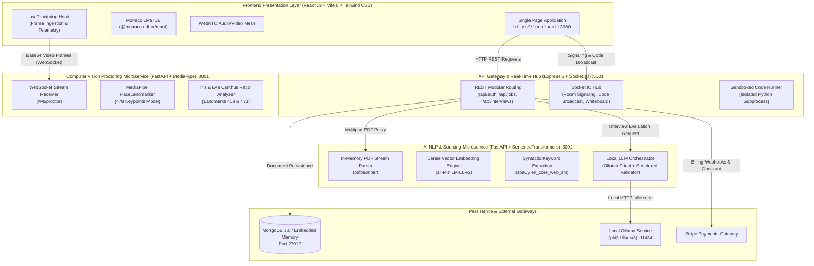

# Procruit — Enterprise Autonomous Talent Intelligence & Assessment Platform

[](https://www.typescriptlang.org/)
[](https://react.dev/)
[](https://nodejs.org/)
[](https://expressjs.com/)
[](https://fastapi.tiangolo.com/)
[](https://www.python.org/)
[](https://www.docker.com/)
[](LICENSE)

**Procruit** is an enterprise-grade autonomous talent intelligence, technical assessment, and biometric proctoring ecosystem. Architected for **Candidates**, **Recruiters**, **Freelance Technical Interviewers**, and **Talent Operations Teams**, Procruit unites in-memory semantic ATS matching, sub-second facial mesh proctoring, synchronized live coding sandboxes, WebRTC peer-to-peer conferencing, and sovereign on-premise post-interview evaluation into a single cohesive platform.

---

## Table of Contents

1. [Platform Overview & Core Tenets](#platform-overview--core-tenets)
2. [High-Level Architecture](#high-level-architecture)
   - [System Topology & Data Flow](#system-topology--data-flow)
   - [Microservice Network Topology](#microservice-network-topology)
   - [Architectural Paradigm & Design Principles](#architectural-paradigm--design-principles)
3. [Core Machine Learning & AI Subsystems](#core-machine-learning--ai-subsystems)
   - [1. Semantic ATS & Resume Parsing Pipeline (`ai-service`)](#1-semantic-ats--resume-parsing-pipeline-ai-service)
   - [2. Real-Time Computer Vision Proctoring Engine (`proctoring-service`)](#2-real-time-computer-vision-proctoring-engine-proctoring-service)
   - [3. Sovereign Post-Interview AI Evaluator (`ai-service`)](#3-sovereign-post-interview-ai-evaluator-ai-service)
4. [Live Coding Sandbox & Ephemeral Execution Engine](#live-coding-sandbox--ephemeral-execution-engine)
5. [Role-Based Feature Matrix & User Journeys](#role-based-feature-matrix--user-journeys)
   - [Candidate Portal](#candidate-portal)
   - [Recruiter Hub & Pipeline Intelligence](#recruiter-hub--pipeline-intelligence)
   - [Freelance Interviewer Marketplace](#freelance-interviewer-marketplace)
   - [Enterprise Operations & Platform Governance](#enterprise-operations--platform-governance)
6. [API & WebSocket Service Catalog](#api--websocket-service-catalog)
   - [Core Express Backend (`:5001`)](#core-express-backend-5001)
   - [Real-Time WebRTC & Socket.IO Signaling](#real-time-webrtc--socketio-signaling)
   - [Proctoring Microservice (`:8001`)](#proctoring-microservice-8001)
   - [AI NLP & Evaluation Microservice (`:8002`)](#ai-nlp--evaluation-microservice-8002)
7. [Repository Structure & Codebase Map](#repository-structure--codebase-map)
8. [Prerequisites & Local Environment Setup](#prerequisites--local-environment-setup)
   - [System Requirements](#system-requirements)
   - [Step 1: Workspace Dependencies Installation](#step-1-workspace-dependencies-installation)
   - [Step 2: Python Virtual Environments](#step-2-python-virtual-environments)
   - [Step 3: Ollama Local LLM Deployment](#step-3-ollama-local-llm-deployment)
   - [Step 4: Environment Variables Configuration](#step-4-environment-variables-configuration)
   - [Step 5: Launching Services](#step-5-launching-services)
   - [Pre-Seeded Enterprise Demo Accounts](#pre-seeded-enterprise-demo-accounts)
9. [Production Docker Deployment](#production-docker-deployment)
10. [Testing, Quality Assurance & Verification](#testing-quality-assurance--verification)
11. [Security, Privacy & Data Protection](#security-privacy--data-protection)
12. [Troubleshooting & Diagnostic Guide](#troubleshooting--diagnostic-guide)
13. [Enterprise Support & License](#enterprise-support--license)

---

## Platform Overview & Core Tenets

Traditional technical hiring workflows suffer from fragmented tooling, vulnerable take-home tests, keyword-stuffed resumes, and subjective candidate appraisals. Procruit resolves these inefficiencies through four architectural pillars:

- **Contextual Semantic Matching**: Transforms raw applicant resumes and job descriptions into 384-dimensional dense vector embeddings (`all-MiniLM-L6-v2`), evaluating genuine syntactic and conceptual alignment rather than superficial keyword density.
- **Continuous Biometric Integrity**: Ingests webcam frames at up to 30 FPS over persistent WebSockets, tracking 478 facial landmarks via Google MediaPipe to compute normalized iris-to-canthus ratios that detect off-screen glances, auxiliary displays, and secondary face presence without recording sensitive video data.
- **Collaborative Real-Time Workspace**: Merges low-latency WebRTC mesh audio/video, real-time Monaco live coding with remote cursor synchronization, collaborative whiteboard canvases, and isolated asynchronous code execution into an integrated browser workstation.
- **Sovereign Multi-Modal Evaluation**: Synthesizes quantitative unit test outcomes, timeline-indexed proctoring anomaly events, and structured interviewer feedback through private, on-premise LLMs (Ollama) with deterministic heuristic fallbacks for absolute operational continuity.

---

## High-Level Architecture

### System Topology & Data Flow



### Microservice Network Topology

| Service | Port | Base URL | Protocol | Runtime Stack | Primary Responsibility |
|---|---|---|---|---|---|
| **Frontend Client** | `3000` | `http://localhost:3000` | HTTP / WSS | Vite 6, React 19, Tailwind CSS | High-density ATS dashboards, candidate portal, Monaco IDE |
| **Backend Gateway** | `5001` | `http://localhost:5001` | HTTP / WS | Node.js 20, Express 5, Socket.IO | Business logic, JWT RBAC, WebRTC signaling, code execution |
| **AI Microservice** | `8002` | `http://localhost:8002` | HTTP | Python 3.11, FastAPI, SentenceTransformers | Resume text extraction, dense vector matching, LLM rubrics |
| **Proctoring Service**| `8001` | `http://localhost:8001` | HTTP / WS | Python 3.11, FastAPI, MediaPipe, OpenCV | Real-time face mesh, iris deviation analysis, anomaly events |
| **Ollama Daemon** | `11434`| `http://localhost:11434`| HTTP | Go / C++ Native (Ollama) | Private local LLM inference (`phi3`, `llama3`) |
| **MongoDB Datastore**| `27017`| `mongodb://localhost:27017`| TCP | MongoDB Community / MongoMemoryServer | Primary document store for platform state and records |

### Architectural Paradigm & Design Principles

1. **Deterministic Processing with AI Augmentation**:
   - Critical evaluation pipelines rely on verifiable mathematics (dense vector cosine similarity and linguistic part-of-speech filtering) rather than non-deterministic autonomous agent loops.
2. **Zero-Retention Ephemeral Privacy**:
   - Resumes uploaded for matching are processed entirely in-memory using byte buffers with zero disk writes. Webcam video frames are parsed in volatile RAM and immediately discarded.
3. **Resilient Fail-Safe Operational Continuity**:
   - If the local Ollama LLM is offline, the backend transitions automatically to a deterministic heuristic scoring engine. If MongoDB is unavailable during local development, an embedded in-memory database (`mongodb-memory-server`) initializes automatically.
4. **Isolated CPU-Bound Workloads**:
   - Heavy machine vision inference and neural embedding operations run in isolated Python processes, preventing event-loop starvation in the Node.js signaling gateway.

---

## Core Machine Learning & AI Subsystems

### 1. Semantic ATS & Resume Parsing Pipeline (`ai-service`)

Hosted in [`ai-service/main.py`](ai-service/main.py), the sourcing pipeline scores candidate resumes against job requisitions through a deterministic 4-stage pipeline:

```
+---------------------------------------------------------------------------------------------------+
|                                 IN-MEMORY RESUME SCORING PIPELINE                                 |
|                                                                                                   |
|  [PDF Stream] ──> [pdfplumber] ──> Clean In-Memory Text Buffer                                    |
|                                          │                                                        |
|         ┌────────────────────────────────┴─────────────────────────────────┐                      |
|         ▼                                                                  ▼                      |
|  [SentenceTransformers]                                             [spaCy en_core]               |
|  all-MiniLM-L6-v2 (384-dim)                                          Noun Chunks & POS Tagging     |
|         │                                                                  │                      |
|  Dense Vector Embedding                                             Technical Keyword Extraction  |
|  CosSim(V_resume, V_job)                                                   │                      |
|         │                                                           Sub-phrase Deduplication      |
|         ▼                                                                  ▼                      |
|   Semantic Score (0-100)                                             Keyword Score (0-100)        |
|         │                                                                  │                      |
|         └────────────────────────────────┬─────────────────────────────────┘                      |
|                                          ▼                                                        |
|                           Dynamic Blending Engine (Formula)                                       |
|                                          │                                                        |
|                                          ▼                                                        |
|                         Composite Match Score (0 - 100)                                           |
+---------------------------------------------------------------------------------------------------+
```

#### Step 1: In-Memory Text Extraction
- Receives uploaded candidate PDFs as raw bytes (`io.BytesIO`).
- Extracts layout-preserved text streams via `pdfplumber`, stripping graphic artifacts and embedded non-text content.

#### Step 2: Dense Vector Semantic Similarity
- Encodes candidate text and job descriptions into 384-dimensional dense vector embeddings using `all-MiniLM-L6-v2`.
- Calculates normalized Cosine Similarity:
  $$\text{SemanticScore} = \max\left(0, \min\left(100, \frac{\vec{u} \cdot \vec{v}}{\|\vec{u}\| \|\vec{v}\|} \times 100\right)\right)$$

#### Step 3: Linguistic Analysis & Technical Keyword Overlap
- Utilizes `spaCy` (`en_core_web_sm`) for grammatical dependency parsing and noun chunk extraction.
- **Filter Heuristics**:
  - Restricts matches to proper nouns (`PROPN`) and common nouns (`NOUN`).
  - Limits multi-word phrases to a maximum of 2 tokens.
  - Excludes non-technical named entity tags (`DATE`, `TIME`, `PERCENT`, `MONEY`, `QUANTITY`).
  - Discards generic job description boilerplate using a stop-word list of 70+ non-technical terms.
  - Cross-references against a curated dictionary of 100+ cloud, language, and framework tokens (`Kubernetes`, `TypeScript`, `PyTorch`, `Kafka`, `Docker`, `GraphQL`).
  - Implements sub-phrase deduplication to prevent composite term penalties when individual constituent tokens match.

#### Step 4: Adaptive Composite Scoring
- **Standard JDs** ($\ge 5$ extracted keywords):
  $$\text{FinalScore} = 0.60 \times \text{SemanticScore} + 0.40 \times \text{KeywordScore}$$
- **Sparse JDs** ($< 5$ extracted keywords):
  $$\text{FinalScore} = 0.85 \times \text{SemanticScore} + 0.15 \times \text{KeywordScore}$$

---

### 2. Real-Time Computer Vision Proctoring Engine (`proctoring-service`)

Located in [`proctoring-service/main.py`](proctoring-service/main.py), this microservice processes incoming camera frames at low latency over persistent WebSockets (`/ws/proctor`).

#### MediaPipe 478-Point Face Mesh Geometry
Operates Google's `face_landmarker.task` model configured with presence, detection, and tracking thresholds at `0.5`.

#### Biometric Gaze & Iris Ratio Analysis
The proctoring engine monitors eye gaze vectors by tracking the spatial relation of each iris center to the anatomical eye boundaries:

```
        Upper Eyelid (Landmark #159)
                    ▲
                    │
Outer Corner ───── ( Iris Center #468 ) ───── Inner Corner
(Landmark #33)      │                         (Landmark #133)
                    ▼
        Lower Eyelid (Landmark #145)
```

1. **Left Eye Configuration**:
   - Inner Corner: Landmark `133`
   - Outer Corner: Landmark `33`
   - Upper Eyelid: Landmark `159`
   - Lower Eyelid: Landmark `145`
   - Iris Center: Landmark `468`
2. **Right Eye Configuration**:
   - Inner Corner: Landmark `362`
   - Outer Corner: Landmark `263`
   - Upper Eyelid: Landmark `386`
   - Lower Eyelid: Landmark `374`
   - Iris Center: Landmark `473`

The horizontal gaze ratio is calculated as:
$$\text{Ratio}_{\text{horizontal}} = \frac{\text{Distance}(\text{IrisCenter}, \text{InnerCorner})}{\text{Distance}(\text{OuterCorner}, \text{InnerCorner})}$$

When horizontal ratios cross calibrated tolerance boundaries ($< 0.35$ or $> 0.65$) across sequential frames, a gaze deviation event is dispatched to the assessment audit ledger.

#### Integrated Multi-Signal Integrity Monitoring
The proctoring system simultaneously monitors and cross-corroborates six critical vectors:
- **`face_lost`**: Absence of facial landmarks for $> 3$ consecutive evaluation frames.
- **`multiple_faces`**: Presence of secondary individuals in the camera field of view.
- **`gaze_deviation`**: Significant gaze vector drift indicating off-screen secondary monitor consultation.
- **`tab_switch`**: Browser window blur detected via the HTML5 Page Visibility API.
- **`clipboard_tampering`**: Interception of unauthorized copy-paste operations inside the IDE.
- **`screenshot_detection`**: Interception of OS print-screen keystrokes.

---

### 3. Sovereign Post-Interview AI Evaluator (`ai-service`)

**Endpoint**: `POST /api/ai/evaluate-interview`

Following the conclusion of a technical interview session, Procruit aggregates quantitative metrics, execution history, and notes into an automated synthesis request:

```json
{
  "interviewId": "65e21a...",
  "candidateCode": "def two_sum(nums, target):\n    lookup = {}\n    for i, n in enumerate(nums):\n        ...",
  "codingScore": 100,
  "codingTestConducted": true,
  "proctorEvents": [
    { "type": "tab_switch", "detail": "Candidate toggled application window", "timestamp": "14:22:01" },
    { "type": "gaze", "detail": "Gaze shifted right toward secondary monitor", "timestamp": "14:23:45" }
  ],
  "interviewerNotes": "Candidate demonstrated crisp understanding of hash map lookups and time-space tradeoffs."
}
```

#### Local LLM Inference via Ollama
- Connects to the local Ollama daemon on port `11434`.
- Auto-detects local models via `GET /api/tags`, defaulting to `phi3` or `llama3`.
- Enforces a low-temperature setting (`0.3`) and JSON schema validation.
- Generates a structured scorecard:
  - `suitabilityScore` (0–100 integer)
  - `strengths` (3–5 bulleted technical highlights)
  - `weaknesses` (3–5 areas for growth)
  - `redFlags` (synthesized from proctoring violation frequencies)

#### Deterministic Heuristic Fallback Engine
If Ollama is offline, unreachable, or times out, Procruit's internal fallback engine immediately executes:
$$\text{BaseScore} = 72 + (\text{CodingScore} - 50) \times 0.3$$
$$\text{FinalScore} = \max(0, \min(100, \text{BaseScore} - (\text{Violations} \times 5)))$$

---

## Live Coding Sandbox & Ephemeral Execution Engine

Technical assessments are conducted inside the Monaco Editor (`@monaco-editor/react`), supporting syntax highlighting, intelligent autocompletion, and multi-language presets.

### Ephemeral Execution Workflow (`server/controllers/codingTestController.js`)
When a candidate triggers code execution:
1. **Isolated Ephemeral Scripting**: Writes the submitted solution to an isolated temporary file (`os.tmpdir()`) formatted as `procruit_${timestamp}_${random}.py`.
2. **Fast-Fail Syntax Compilation**: Executes `python -m py_compile` under a strict 3,000ms timeout to catch syntax anomalies before test execution.
3. **Per-Case Test Harness**: Runs each test case input independently against the compiled code with stdout capture and output diffing.
4. **Resource Guardrails**: Enforces a strict runtime timeout (`EXEC_TIMEOUT_MS = 5000ms`) to intercept infinite loops and process attacks.
5. **Immediate Cleanup**: Unlinks and purges the temporary script inside a `finally` block to prevent disk retention.

---

## Role-Based Feature Matrix & User Journeys

### Candidate Portal
- **Job Discovery & Filtering**: Search technical openings filtered by Engineering, Product, Design, and Marketing departments.
- **Instant ATS Match Scoring**: Upload PDF resumes to receive real-time match ratings, highlighted strengths, and missing skill badges.
- **Collaborative Interviewing**: Join low-latency WebRTC peer-to-peer interview rooms with synchronized Monaco IDE and whiteboard.
- **Assessment Sandbox**: Practice algorithmic challenges with real-time test execution feedback.

### Recruiter Hub & Pipeline Intelligence
- **High-Density Candidate Roster**: Sakrome-style candidate table featuring stage badges (`New`, `Screening`, `Interview`, `Assessment`, `Hired`), department icons, and dual-tone match score bars.
- **Slide-Over Inspector Drawer**: Comprehensive candidate drawer with circular SVG match gauges, skill cloud chips, interview timeline, and instant scheduling CTAs.
- **Analytics & Hiring Matrix**: 4-quadrant KPI cards (Emerald `#10B981`, Cobalt `#2563EB`, Coral `#FF5A36`, Hot Pink `#FF5D8F`), job distribution donut charts, and weekly activity arc gauges.
- **Interviewer Delegation**: Delegate technical evaluations to verified freelance specialists with escrowed milestone payments.

### Freelance Interviewer Marketplace
- **Requisition Gig Board**: Browse open technical interview requisitions with upfront hourly rates.
- **Interview Station**: Host live technical screens with synchronized Monaco editor, split-screen video, and candidate proctoring indicators.
- **Structured Rubric Submission**: Submit standardized evaluation scorecards with automated post-interview AI synthesis.

### Enterprise Operations & Platform Governance
- **RBAC Governance**: Enterprise administration of Users, Organizations, Recruiters, and Interviewers.
- **System Telemetry & Health**: Live monitoring of active Socket.IO rooms, microservice health, and database operations.
- **Stripe Billing Integration**: Organization subscription tiers, assessment packages, and freelance payout management.

---

## API & WebSocket Service Catalog

### Core Express Backend (`:5001`)

The backend exposes 79+ REST endpoints organized across 12 core route modules:

#### Health & Readiness Probes (`healthRoutes`)
- `GET /api/health` — Liveness probe returning process uptime, memory RSS, and system telemetry.
- `GET /api/ready` — Readiness probe validating MongoDB connection, AI service health, and Proctoring service health.

#### Authentication & Authorization (`authRoutes`)
- `POST /api/auth/register-org` — Register an enterprise organization account.
- `POST /api/auth/register-freelancer` — Register a freelance technical interviewer account.
- `POST /api/auth/register-candidate` — Register a candidate account.
- `POST /api/auth/login` — Authenticate credentials and receive a JWT bearer token.
- `POST /api/auth/register-recruiter` — Organization-authenticated endpoint to provision recruiter accounts.
- `GET /api/auth/recruiters` — List recruiters associated with caller's organization.
- `POST /api/auth/change-password` — Update user account password.

#### User Profile Management (`userRoutes`)
- `GET /api/users/profile` — Fetch profile details, skills, and portfolio links.
- `PUT /api/users/profile` — Update bio, hourly rates, or candidate profile.
- `POST /api/users/profile-picture` — Upload avatar image.
- `GET /api/users/interviewers` — List verified freelance interviewers.
- `GET /api/users/candidates` — Query candidates for recruitment matching.
- `GET /api/users/by-id/:id` — Retrieve user profile by user ID.
- `GET /api/users/:email` — Retrieve user by email address.
- `POST /api/users/resume` — Upload candidate resume file.

#### Job Requisitions & Pipeline (`jobRoutes`)
- `GET /api/jobs/` — Query published job listings with keyword and category filters.
- `POST /api/jobs/` — Create a new job requisition.
- `GET /api/jobs/my-jobs` — Retrieve requisitions created by authenticated recruiter/org.
- `GET /api/jobs/applications/received` — Query incoming applications across managed jobs.
- `GET /api/jobs/delegations/reviewing` — Query delegated interviews pending recruiter approval.
- `PUT /api/jobs/delegations/:jobId/approve` — Approve a completed freelance interview report.
- `GET /api/jobs/hirings/new` — Query recent candidate hires.
- `GET /api/jobs/past-jobs` — Query archived job requisitions.
- `GET /api/jobs/:id` — Fetch complete job details and application pipeline.
- `POST /api/jobs/:id/apply` — Submit application with resume for a specific opening.
- `POST /api/jobs/:jobId/delegate` — Delegate interview responsibilities to a freelance specialist.
- `PUT /api/jobs/applications/:id/status` — Advance candidate pipeline status.

#### Candidate Applications & ATS Scoring (`applicationRoutes`)
- `POST /api/applications/:jobId` — Submit application with multipart resume.
- `GET /api/applications/my-applications` — Query applications submitted by candidate.
- `GET /api/applications/:jobId/candidates` — Query ranked candidate list for a requisition.
- `POST /api/applications/:applicationId/retry-ai` — Trigger re-parsing and ATS scoring.

#### Technical Interviews & Scheduling (`interviewRoutes`)
- `POST /api/interviews/schedule` — Schedule an interview and generate meeting tokens.
- `GET /api/interviews/my-interviews` — List interviews for authenticated user.
- `GET /api/interviews/eligible-candidates` — Query candidates eligible for interview scheduling.
- `GET /api/interviews/:id` — Retrieve interview details and session tokens.
- `PATCH /api/interviews/:id/status` — Update interview stage (`Scheduled`, `In-Progress`, `Completed`).
- `DELETE /api/interviews/:id` — Cancel or remove an interview session.
- `POST /api/interviews/:id/feedback` — Submit interviewer evaluation rubric.
- `GET /api/interviews/:id/proctor-log` — Fetch chronological proctoring anomaly events.
- `POST /api/interviews/:id/proctor-log` — Log an anomaly event during the session.
- `POST /api/interviews/:id/complete` — Finalize interview and trigger post-interview AI analysis.
- `GET /api/interviews/my-messages` — Query user direct message conversations.
- `GET /api/interviews/conversations` — Fetch active conversation threads.
- `GET /api/interviews/messages/:userId` — Fetch thread messages with a specific user.
- `PUT /api/interviews/messages/read/:userId` — Mark messages as read.
- `POST /api/interviews/message` — Send a direct message.

#### Algorithmic Coding Assessments (`codingTestRoutes`)
- `POST /api/coding-test/start` — Initialize a coding assessment session.
- `GET /api/coding-test/next-question` — Fetch next algorithmic problem.
- `GET /api/coding-test/:sessionId/next` — Advance question within an active session.
- `POST /api/coding-test/:sessionId/submit` — Submit candidate code for test suite validation.
- `POST /api/coding-test/:sessionId/end` — Conclude coding assessment.
- `GET /api/coding-test/:sessionId/result` — Fetch score and test breakdown.
- `GET /api/coding-test/job/:jobId/candidate/:candidateId` — Retrieve candidate coding assessment results.

#### Freelance Interviewer Operations (`freelancerRoutes`)
- `GET /api/freelancers/services` — Query available interviewer services.
- `POST /api/freelancers/services` — Publish a new interview service package.
- `PUT /api/freelancers/services/:serviceId` — Update service offering details.
- `DELETE /api/freelancers/services/:serviceId` — Remove service offering.
- `PUT /api/freelancers/requests/:id/accept` — Accept interview booking request.
- `PUT /api/freelancers/requests/:id/reject` — Decline interview booking request.
- `GET /api/freelancers/delegations` — List delegated interview requisitions.
- `PUT /api/freelancers/delegations/:jobId/accept` — Accept requisition delegation.
- `PUT /api/freelancers/delegations/:jobId/reject` — Decline requisition delegation.
- `POST /api/freelancers/delegations/:jobId/propose/:candidateId` — Propose evaluated candidate.
- `GET /api/freelancers/gigs/open` — List open interview gigs.
- `POST /api/freelancers/gigs/accept/:gigId` — Claim an open interview gig.
- `PUT /api/freelancers/profile` — Update professional rates and domains.
- `GET /api/freelancers/availability` — Retrieve interview calendar slots.
- `POST /api/freelancers/availability` — Set recurring availability slots.

#### Recruiter Service Marketplace (`recruiterServiceRoutes`)
- `GET /api/recruiter/services` — Browse verified freelance interviewer catalog.
- `GET /api/recruiter/freelancers/:id` — View detailed profile and ratings of interviewer.
- `POST /api/recruiter/services/:serviceId/book` — Book interview service package.

#### Enterprise Administration (`adminRoutes`)
- `GET /api/admin/stats` — Platform-wide metrics (users, active rooms, interviews, tests).
- `GET /api/admin/users` — Super-admin user directory.
- `DELETE /api/admin/users/:id` — Terminate user account.
- `GET /api/admin/jobs` — Directory of all platform requisitions.
- `DELETE /api/admin/jobs/:id` — Administratively remove a requisition.
- `GET /api/admin/freelancers/pending` — Interviewers awaiting credential verification.
- `PATCH /api/admin/freelancers/:id/approve` — Approve interviewer application.

#### Organization Operations (`organizationRoutes`)
- `GET /api/organization/jobs` — Query organization requisitions.
- `GET /api/organization/recruiters` — List corporate recruiters.
- `POST /api/organization/recruiters/invite` — Invite recruiter team member.
- `DELETE /api/organization/recruiters/:id` — Remove recruiter access.

#### Payment & Checkout Processing (`stripeRoutes`)
- `POST /api/payments/create-checkout-session` — Generate Stripe checkout session for platform credits.
- `POST /api/payments/webhook` — Stripe webhook handler for subscription and billing events.

---

### Real-Time WebRTC & Socket.IO Signaling

The real-time hub supports 18 core invariant signaling events:

| Event Name | Direction | Payload Structure | Purpose |
|---|---|---|---|
| `join-room` | Client -> Server | `{ meetingId, role, name }` | Request entry into interview room |
| `waiting-for-host`| Server -> Client | `{ meetingId }` | Notify candidate of waiting room state |
| `admission-request`| Server -> Host | `{ socketId, name, role }` | Prompt host to admit participant |
| `admit-user` | Host -> Server | `{ socketId }` | Grant entry to waiting participant |
| `admitted` | Server -> Client | `{ meetingId, room }` | Acknowledge entry authorization |
| `deny-user` | Host -> Server | `{ socketId }` | Decline candidate admission |
| `admission-denied`| Server -> Client | `{ reason }` | Notify participant of declined entry |
| `admission-canceled`| Server -> Host | `{ socketId }` | Notify host participant left queue |
| `room-users` | Server -> Client | `Array<{ id, name, role }>` | Broadcast active room participants |
| `user-connected` | Server -> Client | `{ socketId, name, role }` | Announce newly connected peer |
| `offer` | Peer -> Peer | `{ to, offer }` | Transmit WebRTC SDP offer |
| `answer` | Peer -> Peer | `{ to, answer }` | Transmit WebRTC SDP answer |
| `ice-candidate` | Peer -> Peer | `{ to, candidate }` | Exchange ICE connection candidate |
| `code-change` | Peer -> Room | `{ meetingId, code, language }` | Synchronize Monaco editor buffer |
| `language-change`| Peer -> Room | `{ meetingId, language }` | Synchronize IDE language preset |
| `proctor-event` | Client -> Host | `{ type, detail, timestamp }` | Relay proctor anomaly to interviewer HUD |
| `kick-user` | Host -> Server | `{ targetSocketId }` | Administratively eject participant |
| `user-disconnected`| Server -> Room | `{ socketId }` | Announce participant departure |

---

### Proctoring Microservice (`:8001`)

- **WebSocket Stream**: `WS /ws/proctor`
  - **Client Frame**: `{ "type": "frame", "data": "<base64 encoded JPEG>" }`
  - **Server Response**:
    ```json
    {
      "type": "gaze_result",
      "gaze": "center",
      "face_detected": true,
      "h_ratio": 0.512,
      "v_ratio": 0.481,
      "timestamp": 1726848000.123
    }
    ```
- **Health Probe**: `GET /health` — Confirms MediaPipe FaceLandmarker model readiness.

---

### AI NLP & Evaluation Microservice (`:8002`)

- **Resume Parsing & Matching**: `POST /api/ai/parse-cv`
  - **Payload**: `file` (multipart PDF) + `job_description` (form-data text).
  - **Response**:
    ```json
    {
      "suitability_score": 88.5,
      "matched_keywords": ["typescript", "react", "docker", "kubernetes", "python"],
      "missing_keywords": ["graphql", "redis"]
    }
    ```
- **Post-Interview Evaluation**: `POST /api/ai/evaluate-interview`
  - **Payload**: JSON containing code, coding test score, proctoring violation events, and interviewer notes.
  - **Response**: JSON containing `suitabilityScore`, `strengths`, `weaknesses`, and `redFlags`.
- **Health Probe**: `GET /health` — Confirms that `SentenceTransformers` and `spaCy` models are loaded in memory.

---

## Repository Structure & Codebase Map

```
Procruit-main/
├── ai-service/                         # Python AI / NLP Microservice (Port 8002)
│   ├── main.py                         # FastAPI server (CV parsing, SentenceTransformers, Ollama)
│   ├── requirements.txt                # Python dependencies (spacy, sentence-transformers, etc.)
│   └── venv/                           # Python virtual environment
├── proctoring-service/                 # Python Computer Vision Proctoring Service (Port 8001)
│   ├── main.py                         # FastAPI WebSocket server (MediaPipe FaceLandmarker)
│   ├── face_landmarker.task            # 478-point MediaPipe model asset
│   ├── requirements.txt                # Python CV dependencies (opencv-python, mediapipe)
│   └── venv/                           # Python virtual environment
├── server/                             # Express.js Backend & Real-Time Gateway (Port 5001)
│   ├── config/
│   │   ├── db.js                       # MongoDB connection & MongoMemoryServer auto-fallback
│   │   └── seedDefaultData.js          # Pre-seeded enterprise demo accounts & coding problems
│   ├── controllers/
│   │   ├── applicationController.js    # Candidate application management
│   │   └── codingTestController.js     # Sandboxed Python test runner
│   ├── middleware/
│   │   └── authMiddleware.js           # JWT authentication and RBAC guards
│   ├── models/                         # Mongoose schemas (User, Job, Application, Interview)
│   ├── routes/                         # 12 Modular REST route definitions
│   ├── scripts/                        # Database maintenance and admin provisioning
│   ├── index.js                        # Express server entry point & Socket.IO signaling hub
│   └── package.json                    # Backend dependencies
├── components/                         # React UI Component Library
│   ├── AdminLayout.tsx                 # Administration sidebar and top navigation chrome
│   ├── Layouts.tsx                     # Main application shell (macOS container, navigation pills)
│   ├── ThemeContext.tsx                # Obsidian Dark / Light theme provider
│   └── UI.tsx                          # Reusable UI primitives (Buttons, Pills, Gauges, Modals, Cards)
├── pages/                              # Core Page Views
│   ├── InterviewRoom.tsx               # WebRTC video mesh, Monaco IDE, live proctoring HUD
│   ├── Public.tsx                      # Public landing page with 3D perspective tablet canvas
│   ├── RankedCandidates.tsx            # Candidate ranking view with slide-over inspector drawer
│   └── Recruiter.tsx                   # Recruiter dashboard (4-quadrant KPI cards, matrix, timeline)
├── hooks/
│   └── useProctoring.ts                # Client proctoring hook (WebSocket frame streaming)
├── utils/
│   └── sakromeCandidates.ts            # High-density candidate fixtures and data utilities
├── tests/                              # Automated Test Framework
│   ├── e2e/                            # Multi-tier E2E testing framework
│   │   ├── framework/                  # Assertion utilities, API probes, and contract validators
│   │   ├── suites/                     # Tiers 1-4 test specifications
│   │   └── run_all.js                  # Master test runner
├── docker-compose.yml                  # Production multi-container orchestration
├── Dockerfile.client                   # Multi-stage frontend Dockerfile (Node -> Nginx)
├── Dockerfile.server                   # Node.js backend Dockerfile
├── Dockerfile.ai                       # Python AI microservice Dockerfile
├── Dockerfile.proctor                  # Python Proctoring microservice Dockerfile
├── nginx.conf                          # Frontend reverse proxy and WebSocket router
├── metadata.json                       # Root platform metadata
├── start_all.bat                       # Windows unified service launcher
├── start_backend.bat                   # Backend and database launcher
├── start_frontend.bat                  # Frontend launcher
├── package.json                        # Root workspace scripts & client dependencies
├── vite.config.ts                      # Vite build configuration and dev proxies
├── tailwind.config.js                  # Tailwind design system tokens
├── postcss.config.js                   # PostCSS configuration
└── tsconfig.json                       # TypeScript compiler configuration
```

---

## Prerequisites & Local Environment Setup

### System Requirements
- **Node.js**: `v18.0.0` or higher (`v20+` LTS recommended)
- **npm**: `v9.0.0` or higher
- **Python**: `v3.10` to `v3.12`
- **MongoDB**: Local MongoDB instance on port `27017` or MongoDB Atlas URI *(Note: If MongoDB is absent, Procruit automatically initializes an embedded `mongodb-memory-server`)*.
- **Ollama** *(Optional for AI post-interview evaluations)*: Download from [ollama.com](https://ollama.com).

---

### Step 1: Workspace Dependencies Installation

Install root and frontend client dependencies:
```bash
npm install
```

Install backend dependencies:
```bash
cd server
npm install
cd ..
```

---

### Step 2: Python Virtual Environments

#### Set Up AI Microservice (`ai-service`)
```bash
cd ai-service
python -m venv venv

# Windows (PowerShell):
.\venv\Scripts\pip install -r requirements.txt
.\venv\Scripts\python -m spacy download en_core_web_sm

# macOS / Linux:
# source venv/bin/activate
# pip install -r requirements.txt
# python -m spacy download en_core_web_sm

cd ..
```

#### Set Up Proctoring Microservice (`proctoring-service`)
```bash
cd proctoring-service
python -m venv venv

# Windows (PowerShell):
.\venv\Scripts\pip install -r requirements.txt

# macOS / Linux:
# source venv/bin/activate
# pip install -r requirements.txt

cd ..
```

> [!IMPORTANT]
> Verify that `proctoring-service/face_landmarker.task` is present. If missing, download it via:
> ```bash
> curl -o proctoring-service/face_landmarker.task https://storage.googleapis.com/mediapipe-models/face_landmarker/face_landmarker/float16/1/face_landmarker.task
> ```

---

### Step 3: Ollama Local LLM Deployment

For private, on-premise post-interview evaluation scorecards without external API dependencies:
1. Start the Ollama engine:
   ```bash
   ollama serve
   ```
2. Pull the default lightweight model:
   ```bash
   ollama pull phi3
   ```
   *(For high-memory environments with 16GB+ RAM, `ollama pull llama3` is supported).*

---

### Step 4: Environment Variables Configuration

#### Backend Configuration (`server/.env`)
Create `server/.env` with the following variables:
```env
PORT=5001
NODE_ENV=development
MONGO_URI=mongodb://127.0.0.1:27017/procruit
JWT_SECRET=procruit_enterprise_jwt_secret_change_in_prod
CLIENT_URL=http://localhost:3000
AI_SERVICE_URL=http://localhost:8002
PROCTORING_SERVICE_URL=http://localhost:8001
STRIPE_SECRET_KEY=
STRIPE_WEBHOOK_SECRET=
OLLAMA_URL=http://localhost:11434
```

#### Frontend Configuration (`.env.local` in project root)
```env
VITE_API_URL=http://localhost:5001
VITE_PROCTOR_WS_URL=ws://localhost:8001/ws/proctor
```

---

### Step 5: Launching Services

#### Option A: Unified Dev Runner (Single Command)
From the project root, start all microservices concurrently:
```bash
npm run dev
```

This concurrently orchestrates:
- `client` (Cyan): Vite dev server on `http://localhost:3000`
- `server` (Green): Express API & Socket.IO gateway on `http://localhost:5001`
- `ai` (Magenta): FastAPI AI microservice on `http://localhost:8002`
- `proctor` (Yellow): FastAPI proctoring microservice on `http://localhost:8001`
- `ollama` (Blue): Local Ollama daemon on `http://localhost:11434`

#### Option B: Windows Batch Scripts
- `start_all.bat`: Spawns all microservices in dedicated console windows.
- `start_backend.bat`: Launches the Express API and database connection.
- `start_frontend.bat`: Launches the Vite frontend client.

---

### Pre-Seeded Enterprise Demo Accounts

The database seeder (`server/config/seedDefaultData.js`) provisions 5 enterprise accounts on startup:

| Persona | Email Address | Password | Permissions & Role Scope |
|---|---|---|---|
| **Platform Admin** | `admin@procruit.com` | `Password123!` | System-wide administrative controls, user directory, system metrics |
| **Organization Admin**| `org@procruit.com` | `Password123!` | Acme Corp administration, company job postings, recruiter assignment |
| **Corporate Recruiter**| `recruiter@procruit.com` | `Password123!` | Full candidate pipeline, ATS drawer, interview scheduling, analytics |
| **Freelance Interviewer**| `interviewer@procruit.com` | `Password123!` | Claiming interview gigs, Monaco room access, rubric scoring |
| **Candidate** | `candidate@procruit.com` | `Password123!` | Job search, CV upload, coding challenge tests, interview room |

---

## Production Docker Deployment

Procruit includes production-hardened Dockerfiles and a unified multi-container `docker-compose.yml` operating on an isolated bridge network (`procruit-network`).

### Build & Deploy Stack
```bash
docker-compose up --build -d
```

### Container Topology Diagram
```
+------------------------------------------------------------------+
|                         procruit-network                         |
|                                                                  |
|  +--------------------+                  +--------------------+  |
|  | procruit-frontend  | :3000 -> :80     |  procruit-backend  |  | :5001
|  | (Nginx SPA proxy)  |                  |  (Node.js Express) |  |
|  +--------------------+                  +--------------------+  |
|                                                    |             |
|                  +---------------------------------+             |
|                  |                 |               |             |
|                  v                 v               v             |
|          +---------------+  +--------------+  +----------------+ |
|          |  procruit-ai  |  |   procruit-  |  |    procruit-   | |
|          |   (FastAPI)   |  |    proctor   |  |     mongodb    | |
|          |     :8002     |  |     :8001    |  |     :27017     | |
|          +---------------+  +--------------+  +----------------+ |
|                  |                                               |
+------------------|-----------------------------------------------+
                   v
         host.docker.internal:11434 (Host Ollama Daemon)
```

To stop and tear down the container cluster:
```bash
docker-compose down
```

---

## Testing, Quality Assurance & Verification

### Static Type Checking
Verify strict TypeScript compilation with zero type errors:
```bash
npx tsc --noEmit
```

### Production Build Verification
Verify production bundling, tree-shaking, and asset minification:
```bash
npm run build
```

### Automated End-to-End Test Suite
Run the multi-tier test framework verifying all platform features:
```bash
node tests/e2e/run_all.js
```

### Service Health Probes
```bash
# 1. Probe Backend Gateway & Persistence
curl http://localhost:5001/api/health
curl http://localhost:5001/api/ready

# 2. Probe AI Microservice Models
curl http://localhost:8002/health

# 3. Probe Proctoring Microservice
curl http://localhost:8001/health
```

---

## Security, Privacy & Data Protection

- **Zero-Persistence Video Processing**: Webcam video streams ingested via WebSockets are analyzed in volatile RAM and immediately discarded. No video streams are saved or uploaded to cloud storage.
- **In-Memory Resume Ingestion**: Resumes uploaded for matching are evaluated directly in memory byte buffers (`io.BytesIO`). Decrypted CV documents never persist on server disks.
- **Sovereign Local LLM Inference**: Post-interview evaluation rubrics are processed using local Ollama models (`phi3`/`llama3`), preventing candidate code and feedback from leaking to external commercial AI platforms.
- **Enterprise Cryptography & RBAC**: Passwords hashed using `bcryptjs` with 10 salt rounds. Stateless authentication enforced via cryptographically signed JSON Web Tokens (JWT) with role authorization guards.

---

## Troubleshooting & Diagnostic Guide

### 1. MediaPipe Model Asset Missing (`face_landmarker.task`)
- **Symptom**: `FileNotFoundError: Model file not found: .../face_landmarker.task`
- **Remedy**: Download the model asset directly into `proctoring-service/`:
  ```bash
  curl -o proctoring-service/face_landmarker.task https://storage.googleapis.com/mediapipe-models/face_landmarker/face_landmarker/float16/1/face_landmarker.task
  ```

### 2. Ollama Connectivity / High Memory Consumption
- **Symptom**: Warning logs indicating `Ollama call failed; Falling back to dynamic mock evaluation`.
- **Remedy**: Procruit automatically recovers via its integrated heuristic fallback engine. If local LLM evaluation is desired, verify Ollama is active (`ollama serve`) and pull the lightweight model (`ollama pull phi3`).

### 3. Port Conflicts
- **Symptom**: `EADDRINUSE: address already in use :::5001` or `:::3000`
- **Remedy**: Terminate existing processes occupying the port:
  ```powershell
  # Windows PowerShell
  Get-Process -Id (Get-NetTCPConnection -LocalPort 5001).OwningProcess | Stop-Process -Force
  ```

### 4. Standalone MongoDB Connection
- **Symptom**: Local MongoDB service is inactive.
- **Behavior**: Procruit's database driver (`server/config/db.js`) detects unreachable MongoDB endpoints and automatically spawns an embedded `mongodb-memory-server` with pre-seeded demo accounts.

---

## Enterprise Support & License

Procruit is distributed under the **ISC License**. For enterprise support, custom integrations, or compliance certifications:
- **Enterprise Portal**: [https://procruit.enterprise](https://procruit.enterprise)
- **Engineering Support**: [support@procruit.enterprise](mailto:support@procruit.enterprise)
- **Security Team**: [security@procruit.enterprise](mailto:security@procruit.enterprise)
